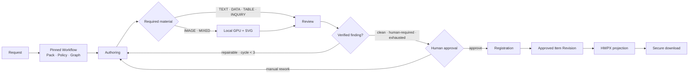
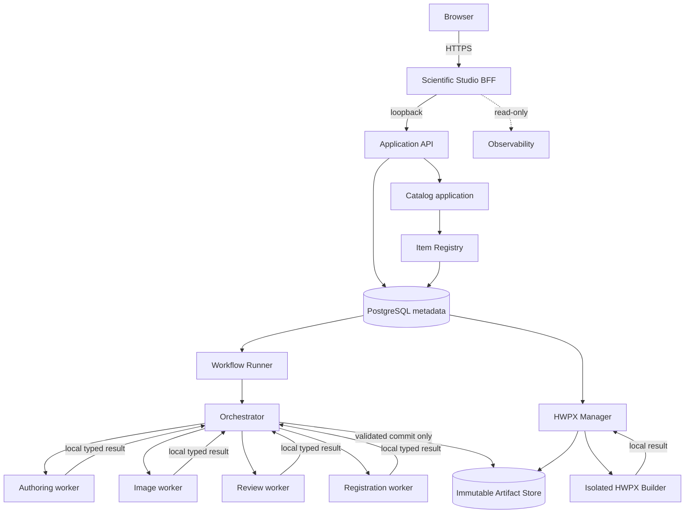

# EOM Scientific Studio

> 기출·교과서 근거를 검색하고, 역할별 검증과 불변 문항 등록, HWPX 검토, 사람 승인을
> 연결하는 protocol-first 평가 문항 제작 플랫폼

EOM은 하나의 프롬프트가 문항 파일을 바로 만드는 도구가 아닙니다. 요청 시점의 Workflow,
Content Pack, 실행 정책과 RAG 근거를 불변 Revision으로 고정하고, 격리된 worker의 구조화 결과를
JSON Schema 2020-12와 Pydantic으로 검증합니다. 최신 단일 문항 경로는 검증된 결과를 먼저
`IN_REVIEW` Item Revision으로 등록하고, 그 정확한 Revision의 HWPX를 사람이 확인한 뒤
`APPROVED`로 전환합니다. PNG와 HWPX는 정본 Item을 참조하는 별도 Artifact Revision입니다.

```text
logical Item
  -> immutable Item Revision
    -> typed component pointers
      -> immutable Artifact Revisions
        -> SHA-256 content hashes
```

## 지금 할 수 있는 일

- Scientific Studio에서 출제 요구를 한 곳에 적고 단원·난이도·자료 구성을 골라 바로 제작 시작
  (별도 요청 분석 단계 없음; 한국어·5지선다는 고정, 초안 저장과 새 요청도 지원)
- Authoring → Image(조건부) → Review → 최대 3회 bounded 개선 → Registration → HWPX Review →
  Human Approval 실행
- 검증된 기출 PDF Graph를 검색해 Evidence Bundle을 만들고, 인용한 evidence·anchor·문항 적용
  위치를 authoring/review 영수증으로 다시 검증
- 표, 수식, `<자료>`, `<조건>`, 탐구, `ㄱ/ㄴ/ㄷ`, 5지선다와 해설을 구조화된 Item으로 등록
- 로컬 GPU 이미지와 결정론적 SVG를 합성하되 외부 LLM·이미지 API는 사용하지 않음
- 승인 Item Revision을 단일 문항 또는 시험지 HWPX로 만들고 보안 다운로드
- 승인 문항, HWPX build, RAG 학습 현황과 Codex slot 사용 상태 조회
- 25문항 모의고사 생산 계획·실행·검토·퇴역을 불변 checkpoint와 영수증으로 관리

## 현재 저장소 릴리스 선

관리자 설정의 실행 설정에서 **출제·일반 검토·강화 검토 모델과 추론 강도**를 각각 선택하는
기능을 운영 배포했습니다. 실제 슬롯의 Codex 모델 목록과 검토된 실행 정책의 교집합만 표시하며,
초안 저장 → 실행 전달 검증 → 관리자 적용 순서로 불변 successor를 만듭니다. 기존 작업의
모델·RAG·프롬프트·실행 pin은 바꾸지 않습니다. `d265a0d0`의 최초 검토 정책은
`gpt-5.6-terra`의 `medium/high/xhigh`였습니다. 현재 허용 범위는 보호된 정책과 실제
슬롯의 검증 결과에서 조회하며, 다른 모델을 목록에서 발견했다고 자동 허용하지 않습니다.
외부 LLM API나 API-key 과금 연결은 없습니다. 운영 릴리스 `d265a0d0`은 실제 HTTPS에서
발견한 실행 설정 목록의 중첩 정보 누락도 수정한 호환 API/Web 릴리스입니다.
앞선 `7de886f1`에서 미적용 초안의 실행 전달 검증 35개를 통과했습니다. 운영 기본값은 그대로이며, 이 검증은
모델의 문항 품질이나 구독 사용 자격을 판정하는 생성 실험이 아닙니다.
문항 요청 화면의 실행 설정 선택란은 제거했습니다. 새 요청에는 내부의 현재 공개된 실행 설정을
사용하되, 기존 작업의 재전송과 진행 중 작업은 원래 고정된 버전을 유지합니다. 관리자 적용 이후의
새 요청이 예전 설정으로 완료된 결과를 잘못 재사용하지 않도록 임시 DB 동시성 검증도 추가했습니다.
[실행 설정 설계·검증](docs/architecture/CODEX_CONTROL_PLANE_MVP_APPLICATION.md#13-administrator-model-selection-2026-10-09-utc),
[네이티브 모델 목록 경계](docs/architecture/CODEX_NATIVE_MODEL_CATALOG_OBSERVATION.md)를 참고하세요.

Codex 업데이트 확인과 실제 실행 호환성 검증은 기존 Orchestrator의 독립된 유지보수
기능으로 분리합니다. 공식 배포 메타데이터 조회는 설치를 수행하지 않으며, 실제 검증은
운영 작업이 없는 점검 시간에 짧은 구조화 응답·PNG 입력으로 순차 실행합니다. 보고서는
CLI·실행 파일·계정 배정·모델·추론 강도를 고정한 Artifact입니다. 새 모델의 허용 범위는
통과한 계정 배정으로 제한하고, 기존 실행 설정·기본값·프롬프트·RAG pin은 유지합니다.
소스 테스트와 실제 모델 실행, 문항 품질 검증은 각각 별도 결과입니다.
공용 Codex 설치를 업데이트할 때는 작업 슬롯01–06뿐 아니라 일반 대화의 전용 슬롯도
별도로 검증합니다. 일반 대화의 새 계약은 선택한 CLI 버전·실행 파일 해시를 고정하며,
호환되는 다음 버전은 코드의 버전 번호를 바꾸지 않고 새 pin과 실제 검증으로 적용합니다.
이 계약만으로 새 버전이 운영 활성화됐거나 모든 미래 버전이 호환된다고 주장하지 않습니다.
[호환성 설계](docs/architecture/CODEX_RUNTIME_COMPATIBILITY.md),
[일반 대화 런타임 계약](docs/architecture/GENERAL_CHAT_CODEX_RUNTIME_EVOLUTION.md),
[운영 점검 절차](docs/operations/CODEX_RUNTIME_COMPATIBILITY_RUNBOOK.md)를 참고하세요.

검토 근거의 연결 규칙을 명확히 한 `generated-knowledge-item@1.20.16`은 별도의 저장소
후보입니다. 운영 활성 버전은 `generated-knowledge-item@1.20.15`로 유지되며, 모델 설정 기능
배포나 초안 검증이 Content Pack을 자동 활성화하지 않습니다.

유사 문항 보조 자료를 출제·검토에 활용하는 `generated-knowledge-item@1.20.17`도 저장소
후보로 추가했습니다. 서버가 고정한 실행 계획에서 자료 전달 여부를 판별하고, 제공된 경우에만
원본·후보의 조건, 중간 관계, 핵심 착상과 오개념을 비교하도록 했습니다. 점수를 승인이나 같은
풀이의 확률로 해석하지 않으며 기존 Graph 근거·최대 3교·문항 편집 규칙은 유지합니다.
이 프롬프트와 자료 배치 경계의 소스 검증은 실제 운영 연결·모델 실행을 뜻하지 않습니다.
[유사도 자료 전달 구현 경계](docs/architecture/SYSTEM_RAG_SIMILARITY_CONTEXT_IMPLEMENTATION_BOUNDARY.md#20-compatible-reference-aware-pack-and-trusted-prompt-mode)를 참고하세요.

출제 실행기에서 기존 Orchestrator의 실제 자료 배치 콜백으로 전달하는 연결도 보강했습니다.
고정된 조회와 같은 사용자의 현재 권한을 확인하며, 자료 읽기와 마지막 재확인은 같은 DB
작업 안에서 수행합니다. 기존 인증의 만료 시간을 늘리거나 저장된 사용자 ID를 권한으로
대신 쓰지 않습니다. 현재는 명시적으로 주입한 bounded 조회 소유자 연결까지의 저장소 구현이며,
공용 API의 자동 준비·다중 사용자 운영 활성화와 실제 문항 실행 승인은 아직 별도 단계입니다.

보조 자료는 정본 Artifact로 발행해 같은 조회를 쓰는 문항들이 참조하며, 전달 직전 자료의
현재 승인 상태를 일괄 재확인합니다. 일반 단일 문항에 시험지 생산용 필드를 추가하지 않습니다.
문항 요청의 한 번의 인증을 요청 안에서만 재사용하고, Catalog 수신부에서 현재 설치된 API와
실제 연결 상대 프로세스를 함께 확인하는 소스 경계까지 보강했습니다. 비밀번호·토큰 저장이나
만료 연장은 없습니다. 공용 API의 비동기 준비·다중 사용자 운영 연결과 실제 문항 실행은
아직 별도 단계이며, 이 구현을 운영 활성화 증거로 해석하지 않습니다.

저장소의 완료 QUERY 조회는 실행 권한과 분리해, 현재 인증된 사용자의 공식 자료 조회 권한으로
다시 확인하는 전용 경로를 지원합니다. 과거 세션을 연장하거나 새 실행 권한으로 대체하지 않으며,
조회 결과·완료 영수증의 승인 철회와 원래 해시 변경도 마지막 전달 전에 검사합니다.
출제용 보조 자료를 게시하는 준비 단계는 조회와 별개로 현재 출제 권한을 확인하고,
전달 직전에도 다시 검사합니다. 조회 권한만으로 출제·게시 권한이 생기지 않습니다.
이 보완은 저장소 구현이며 운영 활성화 증거와 구별합니다.
여러 문항의 출제·검토가 겹칠 때는 문항별로 고정한 원래 QUERY 참조를 읽는 공유
어댑터를 준비했습니다. 다른 사용자의 조회 결과나 마지막 실행 결과로 대체하지 않습니다.
서버 내부 준비 값은 최초 계획·조회 참조·START 명령과 한 트랜잭션에서 저장하도록 연결했고,
재전송·충돌·롤백까지 소스 검증했습니다. 공개 요청 형식은 바꾸지 않았으며,
실제 웹 요청의 자동 준비·정식 소유자 연결과 운영 어댑터 활성화는 아직 완료 전입니다.

일반 대화(`일반 → ChatGPT`)는 별도 상주 `chat` 슬롯으로 운영되고 있습니다.
기존 작업 슬롯01–06과 분리한 로컬 Codex에서 계정별 기록·이어 묻기·안전한 Markdown 표시를
제공합니다. 실제 답변·사용자 격리·재시작 기록 보존을 검증했으며 사용자도 동작을 확인했습니다.
운영 증거는 [채팅 구현 기록](docs/status/GENERAL_CHAT_IMPLEMENTATION_2026-10-07.md),
격리·동시성 계약은 [ADR0212](docs/adr/0212-general-chat-dedicated-capacity.md)를 참고하세요.

내부 자료 연결은 [상세 기획](docs/architecture/GENERAL_CHAT_INTERNAL_KNOWLEDGE_INTEGRATION_PLAN.md)에
따라 C04/C05에 이어 대화형 검색·조회까지 운영 연결했습니다. 이제 첨부 없이 요청해도 Codex가 내부 문항을
검색하고 실제 내용을 읽어 답합니다. 검색은 개념·최근 문항·공식 시험의 기존 indexed 경로를
사용하며, 턴당 검색 최대 4회·조회 1회·문항 3개로 제한합니다. 수동 검색·첨부도 유지합니다.
정확한 Item Revision, 고정 Graph의 기초분석에 연결된 승인 풀이보고서 요약을 실제 답변에
참고합니다. 정본 근거·모델 제안·일반 지식·자료 부족·
시각이 있는 시스템 관측을 구분하고, 검증된 출처 버튼으로 원문 Preview를 열 수 있습니다.
검색 scope는 Item 읽기와 채팅 권한의 교집합이며, 이어 묻기와 기록 조회에서도 권한을 재확인합니다.
EOM 어시스턴트는 제작·검토·HWPX 업무를 안내하지만 채팅으로 제작·승인·계정 변경을 실행하지
않습니다. 무제한 전체-corpus 스캔, 그림 픽셀 확인이나 교과서 접근 권한 확대는 포함하지 않습니다.
실제 HTTPS에서 첨부 없는 검색→조회→출처 답변, 풀이보고서 활용, 같은 revision의 후속 대화,
출처 이동·동일 요청 replay·기록 보존을 검증했습니다. C06의 설치 pins와 실제 실행 증거는
[대화형 내부 검색 운영 검증](docs/status/GENERAL_CHAT_AGENT_SEARCH_ACCEPTANCE_2026-10-08.md)에,
이전 수동 첨부·PC/모바일 화면 검증은
[대표 에이전트 운영 연결 기록](docs/status/GENERAL_CHAT_REPRESENTATIVE_ACCEPTANCE_2026-10-08.md)에 있습니다.
검색 책임·성능·실제 inventory는 [검색 설계](docs/architecture/GENERAL_CHAT_KNOWLEDGE_SEARCH_DESIGN.md)에
기록합니다. 승인 여부와 Graph 반영 여부는 서로 다른 상태로 표시합니다.
제작 문항 필터는 정식 `INTERNAL_EOM` 출처 프로필이 있는 문항만 포함합니다. 현재 출처
프로필이 없는 기존 106개 문항은 ‘최근 문항’에서 조회되며 임의로 출처를 재분류하지 않습니다.

교과서 근거도 대화 답변에 운영 연결했습니다. Codex가 출제 경로와 같은 공식 GraphRAG
조회 경계를 이용하여 허용된 교과서·기출·승인 문항 분석을 참고하며, 승인 분석과 원문 인용은
구분합니다. 기존 문항 도구에 RAG 조회 최대 2회를 더하되 전체 도구 호출은 턴당 7회,
RAG 출처는 3건으로 제한합니다. 실제 HTTPS에서 교과서 답변·출처 카드·동일 근거 후속 대화와
기존 기록 보존을 검증했습니다. 권한 확대나 전체 교과서 품질 보장은 아닙니다.
[교과서 RAG 운영 검증](docs/status/GENERAL_CHAT_TEXTBOOK_RAG_ACCEPTANCE_2026-10-09.md),
[설계와 지원 경계](docs/architecture/GENERAL_CHAT_TEXTBOOK_RAG_DESIGN.md)를 참고하세요.

문항의 **핵심 착상이 다른 문항 풀이에 어디서 통하는지** 찾는 opt-in 경계를 구현하고,
호환 API/platform component의 현재 설치는 `8e36e6de` release입니다. 기존 승인 풀이보고서와
exact Graph/Item 근거로 비교 표현을 만들고, 제거 가능한
로컬 임베딩으로 후보를 찾은 뒤 Orchestrator의 bounded Codex 쌍 비교에서 조건·추론의 대응과
차이를 검증합니다. 사람의 전이 평가와 모델 가설은 별도이며, 사용자 지시에 따라 사람
평가는 이번 완료 조건에서 제외합니다. 기존 RAG·출제·승인 경로를 대체하지 않습니다.
실제 `guiadmin` 인증과 original 기출 모집단 520개의 BGE-M3 로컬 CPU 실험에서
**520/520 profile, 1,560개 표현의 MEASURED/COMMITTED**를 확인했습니다. 기존 E5의
길이 부족 결과는 별도 이력으로 보존합니다. V11 비교 control도 공식 PREPARE/RELEASE를
완료했습니다. 두 고정 쌍의 명시적 successor는 **COMPLETED/MEMBER_VERIFIED**이며,
원 key 두 건과 retry key 두 건의 replay가 모두 PASS입니다. 원 실패는 그대로 보존하며,
실제 운영에서 추가 확인한 terminal-step 잠금 권한과 unique 참조 배열 정렬의 최소 보완을
운영에 반영했습니다. 두 실제 machine 판정은 **INSUFFICIENT**입니다. 개념·소재의
유사성은 설명했지만 각 쌍의 한쪽에 핵심 추론 후보가 없어 전이를 단정하지 않았습니다.
보존된520개 profile 중 후보 있음425/없음95이며 이 카운트는 교육적 정확도 지표가 아닙니다.
실패 결과를 성공으로 바꾸거나 권한을 확대하지 않았으며 교육 품질 PASS를 주장하지 않습니다.
원래 기출만의 범위·쌍별 재인가·전용 실행 계획을 검증하고, 같은 후보 집합에서 본문·풀이 근거·
메타데이터를 비교하는 로컬 CPU 실험 경로도 구현했습니다. 실제 모델의 합성 입력 시험은
실제 기출 품질 평가와 구분합니다.
[보존한 설계 원문](docs/architecture/ITEM_INFERENCE_TRANSFER_DESIGN_ORIGINAL.md),
[구현 계획](docs/architecture/ITEM_INFERENCE_TRANSFER_IMPLEMENTATION_PLAN.md),
[첫 구현·CPU 실험·검증 기록](docs/architecture/ITEM_INFERENCE_TRANSFER_FIRST_CHECKPOINT.md)을 참고하세요.
[실험 계약](docs/architecture/ITEM_INFERENCE_TRANSFER_EXPERIMENT.md)과
[전용 실행 목적](docs/architecture/ITEM_INFERENCE_TRANSFER_EXECUTION_PURPOSE.md)에 후속 경계를 기록합니다.
[인증 자료 조회·전용 실행 연결](docs/architecture/ITEM_INFERENCE_TRANSFER_FOURTH_CHECKPOINT.md)은
1,241개 통합 source 검사, 추가 회귀와 임시 PostgreSQL 52개 검증을 기록합니다. 인증 API와
Catalog owner·전용 resolver/Runner는 소스에서 연결됐습니다.
[후속 제출·결과·보호된 실험](docs/architecture/ITEM_INFERENCE_TRANSFER_FIFTH_CHECKPOINT.md)에서
현재 권한 재인가, atomic Workflow/V21/START, canonical 결과 조회 및 optional CPU/Artifact
owner 호출부를 검증했습니다. 고정 격리 CPU runtime/model 설치와 승인된 no-forward 격리 검증,
호환 공유 release·migration 0051·일곱 보호 callback·API ready·8개 service 복원은 PASS입니다.
위 단계의 역사적 source 회귀는 2,609 PASS입니다. 현재 설치는 개념·소재·핵심
착상을 각각 설명하는 PairResult1.1/Workflow1.1/role1.30/V22 successor를 추가하며,
기존 family와 prompt bytes를 보존합니다. 실제 READ의 내부 모델 검증 실패를 진단하고,
Graph 후보 pool과 bounded 64개 baseline의 상한 불일치를 합성 자료로 재현해 보완했습니다.
원문·모집단은 보존하고 baseline prefix 제한을 명시하며, 최종 출제 Evidence와 구분합니다.
실제 READ·owner PREPARE/RELEASE·CPU corpus 실험·최종 두 쌍 비교/replay와 최초 설계
대조를 완료했습니다. 실패 보존형 retry는 released attempt1 제약을 변경하지 않고 기존
START queue에서 같은 logical pair의 successor를 생성합니다. 최신 source 회귀는2,899 PASS,
actual API privilege matrix의 disposable PostgreSQL26 PASS, 최종 console49 PASS입니다.
DB migration·새 queue·권한 확대는 없습니다. 역사적 suite와 이 수치를 합산하지 않습니다.
사람 평가 미실시는 blocker나 자동 성공이 아닙니다.
[최초 설계 대조와 자동 검증 범위](docs/architecture/ITEM_INFERENCE_TRANSFER_FINAL_CONFORMANCE_GAPS.md),
설치 component와 역사적 실패·남은 gate는
[실제 운영 검증 기록](docs/architecture/ITEM_INFERENCE_TRANSFER_LIVE_ACCEPTANCE.md)에 구분합니다.
[최종 설계 대조·부족 판정의 의미·실제 PNG 샘플](docs/status/ITEM_INFERENCE_TRANSFER_FINAL_ACCEPTANCE_2026-10-12.md)도
참고하세요. 샘플은 실제 조회한 문항 텍스트의 비교본이며 원본 페이지 그림이 아닙니다.

다음 단계의 [GraphRAG·유사도 공통 연결과 증분 임베딩 설계](docs/architecture/SYSTEM_RAG_SIMILARITY_AND_INCREMENTAL_EMBEDDING_DESIGN.md)는
신규·개정된 승인 자료만 벡터화하고 동일 입력의 벡터를 재사용하는 자동 갱신과,
기출변형·출제·검토·ChatGPT·시험지 구성의 공통 소비 경계를 정리합니다. 모델 가중치를
매번 재학습하는 기능이 아닙니다. 기존 실험은 영속 운영 인덱스가 아니므로 최초 구축과
이후 증분 갱신은 별도 구현·검증 단계입니다. 1~2일 핵심 실행 계획과 대화 삭제 후속 항목을
포함하며, 이 문서만으로 새 기능이 운영 활성화됐다고 판단하지 않습니다.
추가 요청에 따라 동일 모델·입력의 CPU/GPU 성능·검색 일관성을 비교하고, GPU가 우수하며
격리·자원 경합 검증을 통과하면 운영 기본값 전환까지 진행합니다. 아직 비교 결과나
GPU 기본값 활성화가 완료됐다는 뜻은 아닙니다.

증분 인덱스의 입력·결과/float32 shard, pointer-only Catalog registry, 동일 payload의
CPU/CUDA encoder와 기존 Orchestrator의 Artifact 게시 경로를 구현·소스 검증했습니다.
같은 요청은 원래 작업을 재사용하고, 신규 입력이 없으면 Workflow를 만들지 않습니다.
기존 source·report·Graph·정책과 현재 사용자 권한은 대체하지 않습니다.

10/15에는 실제 사용자 인증으로 원 QUERY 작업을 이어서 완료했고, 같은 key 재전송과
정본 QUERY→공통 유사도 context 조회까지 통과했습니다. 당시 인덱스2/520에서 조회한 결과는
`PARTIAL`입니다. 이후 한 번의4건 증분 처리 검증에서 CONTENT_ONLY 인덱스 **6/520**을 확인했고,
원래2건의 벡터·연결과 이전 revision은 보존했습니다. 10/16에는 새 신원12/소스d4846220의
세 표현 제한 실행을 모두 완료했습니다. 본문7/520·풀이 특징1/520·메타데이터1/520,
벡터/연결 각9개이며 기존6개는 그대로입니다. 정본 해시·수치·연결 검증 후 정상 종료했고,
상시 인덱싱·전체 coverage 완료는 아닙니다.
이후 API와 전용 상주 owner의 호환 설치·실제 기동까지 확인했지만,
일반 웹 요청의 자동 준비·다른 소비자/GPU 활성화 완료는 아닙니다.
[실제 완료·재전송·부분 coverage 증거](docs/status/REFERENCE_QUERY_LIVE_ACCEPTANCE_2026-10-15.md)를 참고하세요.

아래 표는 경계별 누적 검증 기록도 포함합니다. 이전 행의 소스 검증 당시 ‘미활성’은
뒤에 기록된 운영 활성화를 취소하는 뜻이 아닙니다. 현재 운영 coverage는
CONTENT_ONLY7/520·CONCRETE_FACETS1/520·METADATA_ONLY1/520입니다.
첫 제한 실행은 정상 종료했습니다. 이후 기존 접근 정책을 그대로 둔 승인 문항+기출 범위의
최대4건 제한 검증도 완료했습니다. 새 범위는 본문11/545·풀이 특징5/545·메타데이터5/545이며,
기존9개 벡터를 보존하고12개만 새로 계산했습니다. 초기 조회에서 풀이보고서 대기25개를 별도로
확인했고, 원래 기출520개와 분모를 구분합니다. 저장 해시·수치·계보 검증 후 정상 종료했습니다.
[승인 문항 연결 검증](docs/operations/LOCAL_INDEXING_ADMITTED_ITEM_SCOPE_2026-10-16.md).
상시 처리·일반 소비자·GPU 기본값은 아직 미활성입니다.
벡터가 이미 있어도 인덱스가 없거나 문항 구성이 바뀌면, 기존 벡터만 재사용해 갱신하는 경로를
기존 작업 큐·등록·완료 기록까지 연결했습니다. 임시 PostgreSQL에서 새 계산 작업 없이 완료,
중단 후 재개와 오래된 구성 거부를 검증했습니다. 기존 요청·중복 방지는 유지하며,
[새 실행 경로의 운영 설치·활성화는 아직 별도](docs/architecture/LOCAL_EMBEDDING_INDEX_MEMBERSHIP_REFRESH.md)입니다.
[전체 목표의 요구사항·증거·남은 작업](docs/status/SYSTEM_RAG_GOAL_REQUIREMENT_AUDIT_2026-10-15.md)을
별도로 대조하며, 이 표의 일부 PASS를 전체 완료로 사용하지 않습니다.

| 증분 인덱스 경계 | 검증 증거와 명시된 시점의 활성 상태 |
| --- | --- |
| 계약·registry·Artifact·수치 검증·atomic submission·exact claim/native dispatch | SOURCE_PASS; 실제 seed+delta와 후속4건 증분 처리 성공. vector/binding 각6건, 불변 index revision3(CONTENT_ONLY6/520), 기존2건 재사용 확인. 별도 QUERY의 실제 완료·같은 key 재전송·context 조회 PASS; INDEX 자체의 실제 same-key replay와 상시 연결은 별도 |
| exact pinned index read | SOURCE_PASS; 현재 권한 재확인·일괄 binding 조회·선택된 벡터 읽기 구현. 실제 QUERY→context에서 exact index와2/520 coverage 읽기 PASS; 일반 웹 소비는 미활성 |
| 공통 유사도 context 조립 | SOURCE_PASS; 기출변형용 승인 anchor·3개 독립 view·현재 권한 재확인334 PASS. 실제 bounded QUERY에서 권한 있는520개/연결2개·후보1개를 PARTIAL로 조회 PASS; 일반 소비자 연결은 미활성 |
| 25문항 구성의 유사도 관측 | SOURCE_ONLY/NOT_ACTIVE; ordered25 cohort·기존 DOCUMENT 벡터로 표현별 최대300쌍을 독립 관측. 정확한 Assembly 버전/해시/순서에 묶인 Catalog·읽기 전용 API까지 연결했으며, 보고서 부족·권한 거부·시험지 철회를 구분. 시험지의 원래 Graph와 별도로 관측용 Graph도 명시적으로 고정. API/Catalog 모두 별도 opt-in 기본 꺼짐; 새 인코딩·자동 탈락·Assembly/HWPX 수정 없음. 실제 사용자 검증·GUI 노출·운영 활성화는 후속이며 전체 C5 완료가 아님. [계약·구현 경계](docs/architecture/SYSTEM_RAG_EXAM_OBSERVATION_DESIGN.md) |
| 신규 출제·검토의 참고 근거 전달 | 일반 출제의 Web→기존 HTTP 시작→공식 Evidence 참고 선택→준비1.1/ITEM_AUTHORING→plan24→출제·검토 연결 구현. 정상적인 참고 없음·인덱스 미준비는 명시적 기록 후 기존 plan19로 진행하며, 권한·파일 오류나 대기를 성공으로 바꾸지 않음. 최종 집중112·임시 PostgreSQL162·strict type8 PASS(중복 합산 안 함). 기존 기출변형·영수증·최대3교 유지. API/Catalog의 기반 코드는184d6dca에 설치됐지만 소비자 설정·Pack·Web 신규 활성화와 실제 사용자/worker 검증은 미완료. 새 요구·초안 직접 검색도 별도 미완료. [정확한 범위·실행 증거](docs/architecture/SYSTEM_RAG_AUTHORING_REFERENCE_CONTEXT.md) |
| 공식 근거 묶음의 참고 문항 선택 | SOURCE_PASS; 원래 Evidence5 안에서만 승인 보고서가 있는 비정답형 기출 참고 패턴1건을 선택. 실제 임시 DB·정본 파일 게시/재조회 검사에서 발견한 메타데이터 선조회 누락을 기존 일괄 조회로 수정. 관련 소스364·임시 PostgreSQL175·타입2 PASS(중복 합산 안 함). 자료 내용·순위의 검증 입력은 합성이며, 실제 사용자/원본 자료 권한·운영 활성화는 별도. 권한 거부·원본 불일치를 ‘참고 없음’으로 숨기지 않음. [선택·실제 저장 검증 경계](docs/architecture/SYSTEM_RAG_AUTHORING_REFERENCE_CONTEXT.md#original-evidence-persistence-verification-boundary) |
| 유사도 결과의 실행계획 전달 준비 | SOURCE_PASS; plan23은 workflow1.16·원문·Evidence를 유지하며 출제/검토에만 보조 context와 선택 후보 자료를 전달. 최초 계획 저장·정확한 재실행·출제/검토 영수증·등록 출처의 plan23 호환과 Evidence-only 조회 분리까지 관련764 PASS·타입7·후보3038bdf2의3-wheel/RECORD·owner용2-wheel 검증 PASS. 아직 호환 Pack·실제 API/작업 실행기 연결·운영 활성화는 미완료. [계획·영수증 연결 경계](docs/architecture/SYSTEM_RAG_SIMILARITY_CONTEXT_IMPLEMENTATION_BOUNDARY.md#19-plan23-preparation-replay-and-evidence-result-compatibility) |
| 신규 문항 최초 저장의 실제 DB 검증 | DISPOSABLE_DB_PASS; 실제 API·resolver·plan 저장을 PostgreSQL0055에서 검증. 신규6건을 포함한 기존 보호 실행 경로74 PASS, 소스26 PASS·strict type3 PASS. 동시 동일 요청/다른 준비값 경쟁, 정확한 재전송, 전체 롤백, 불변·FK·unique 제약 확인. 인증·Evidence·QUERY 선택은 합성 입력이며 실제 사용자 조회나 운영 활성화 증거가 아님. [검증 경계](docs/architecture/SYSTEM_RAG_SIMILARITY_CONTEXT_IMPLEMENTATION_BOUNDARY.md#32-actual-postgresql-plan23selector-persistence-gate) |
| API–Catalog의 문항 제작용 유사도 준비 전달 | SOURCE_PASS; 완료된 QUERY의 결과를 기존 owner로 게시하고 API는 작은 파일 참조와 현재 결과를 검증해 기존 private handoff 생성. 실소켓→실제 첫 plan23 저장/재전송, 권한 철회·실패 후 중복 방지 포함262 PASS; 별도 API47·PG78 PASS. 별도 opt-in 기본 꺼짐이며 일반 HTTP 자동 준비·native QUERY 생산·운영 활성화는 아직 미완료. [연결 경계](docs/architecture/SYSTEM_RAG_SIMILARITY_CONTEXT_IMPLEMENTATION_BOUNDARY.md#36-api--catalog-preparation-publication-transport) |
| 일반 출제·검토 실행기의 Catalog 자료 읽기 | SOURCE_PASS; app-role 실행기가 고정 소켓으로 저장된 plan23/단계/QUERY만 선택하고 Catalog가 실제 작성 요청자와 현재 자료를 재인가. 기존 DB fence·최대3교·Evidence 경계 유지. 별도 opt-in과 runner-only operation/임시 소켓 ACL 구현, 기본 꺼짐. 소스361·기동 ACL10(8개 중복)·strict type12 및 PG74 PASS. 실소켓/로컬 ACL은 시험했지만 IAM/source/계정 역할은 합성 입력이므로 운영 신원·소비자 활성화 증거는 아님. [소유권 연결 경계](docs/architecture/SYSTEM_RAG_SIMILARITY_CONTEXT_IMPLEMENTATION_BOUNDARY.md#33-ordinary-role-runner--catalog-current-source-materialization) |
| genuine QUERY 입력·encoder/handoff·실행 계약 | SOURCE_PASS; 정본4파일·기존 큐의 QUERY별 claim/완료 검증. 회귀718·임시 DB68 PASS. 호환 owner의 실제 정의/정책·계산·정본 context 검증 PASS; 새 상주 서비스와 일반 소비자 활성화는 별도 |
| 고정 CPU QUERY 실행 어댑터 | SOURCE_PASS; private/root handoff·공통 capacity·재시작 중복 차단. 고정 unit/설정/polkit 설치·UID990 사전확인·실제 owner 허용/거부7 PASS. 실제 사용자 capture로 원 QUERY 계산·완료·정본 읽기 PASS |
| QUERY Job·실행·정본 완료 조회 | SOURCE_PASS; 원 Job/4개 checkpoint·claim 복구·현재 권한/정본 완료 조회 구현. caller-root capture3→2 보완(source376·추가 focused5 PASS, 중복 합산 안 함). 호환 owner에서 실제 Job/Workflow 완료·same-key replay·정본 context PASS; 일반 소비자는 미활성 |
| QUERY 입력 준비의 전체 자료 반복 읽기 제거 | SOURCE_PASS; 조회 대상1개만 기존 selected-source 경계로 준비하고 등록 인덱스·벡터·권한 검증은 유지. 검색 결과의 전체 모집단/coverage·늦은 재인가는 그대로 유지. 합성2/520/1024 자료 operation-count·정본 입력 bytes 동일성 포함359 PASS, 임시 DB78·strict type3 PASS. 실제 실행 지연을 발견해 수정한 후보이며 운영 성능 개선 완료로 주장하지 않음. [지연·검증 범위 기록](docs/architecture/SYSTEM_RAG_SIMILARITY_CONTEXT_IMPLEMENTATION_BOUNDARY.md#37-anchor-bounded-native-query-source-validation-2026-10-15) |
| QUERY 시작·실행 식별 기록의 원자적 저장 | SOURCE_PASS; RUNNING 단계와 원 launch/ALLOCATION을 같은 fenced root에서 저장한 뒤 SQL 밖에서 실행. source309·임시 DB82·strict type3 PASS. 호환 owner의 실제 원 ALLOCATION 기반 재개/완료 PASS; 과거 할당 없는 다른 작업은 보존. [원자성 검증](docs/architecture/SYSTEM_RAG_SIMILARITY_CONTEXT_IMPLEMENTATION_BOUNDARY.md#38-atomic-step-start-and-native-allocation-2026-10-15-design) |
| 원자적 QUERY owner 설치·사전검사 | 호환 backport517e4551의2-wheel/RECORD·격리 import·source bytes 검증 PASS. staging 누락 중단 후 같은 원 Workflow/START/Job을 지원 경계로 이어 완료, 동일 key 재전송과 정본 context PASS. 별도의 과거 unallocated 작업과 실패 기록은 보존. 공유 API/runner 변경 없음. [실제 완료 증거](docs/status/REFERENCE_QUERY_LIVE_ACCEPTANCE_2026-10-15.md) |
| QUERY 요청 준비 공통 application | SOURCE_PASS; 실제 operator와 이미 pin된 context/설정으로 기존 정본 요청을 구성하고 atomic 접수 재사용. 동일 key는 원 audit/pin 유지, 현재 권한 재검증. source273·임시 DB87(동시 최초 준비 포함)·strict type2 PASS. 새 schema/queue/권한 없음; 일반 HTTP의 자동 준비·native 생산 연결·운영 활성화는 미완료. [책임·검증 범위](docs/architecture/REFERENCE_QUERY_REQUEST_PREPARATION.md) |
| 기출 기준 최초 QUERY 선택·접수 연결 | SOURCE_PASS; 공식 선택 자료 조회로 기출1개의 source/report와 세 view의 현재 인덱스를 최초1회 고정하고 기존 QUERY/START에 연결. 재전송은 원 요청을 재사용하며 없는 보고서/인덱스는 작업 생성 전 구분. 실제 파일·DB의 잠금/재전송 검증 포함source404·임시 DB 등록33/단계90·strict type5 PASS. 신원/원문 선택 seam은 합성이며 일반 HTTP·native transport·운영 소비자 활성화는 미완료. [최초 선택 경계](docs/architecture/REFERENCE_QUERY_INITIAL_CONTEXT_CAPTURE.md) |
| API→native QUERY 준비·접수·유한 실행 | SOURCE_PASS; 기존 로그인 상태를 전달하는 Unix 소켓 계약/client/handler와 실제 QUERY 접수 application·단일 실행 드라이버 구현. 저장 후에만 기존 Runner를 호출하며 같은 key의 동시 접수/재조회·권한 철회/롤백과 정본 없는 완료 상태 거부를 임시 PostgreSQL102건에서 검증. 공유 회귀784·strict type9·3-wheel/RECORD·격리 import/소스 일치 PASS. 실제 로컬 소켓/HMAC은 검증했지만 신원·source/model seam은 합성이며 보호된 상주 서비스·일반 HTTP·운영 소비자 연결은 미완료. 기존9-member 설치와 신규12-member source witness를 혼합하지 않음. [검증·남은 범위](docs/architecture/REFERENCE_QUERY_NATIVE_PREPARATION_TRANSPORT.md) |
| QUERY 전용 상주 서비스 구성 | SOURCE_PASS; 닫힌 설정 계약·비특권 요청 서버·실제 사용자별 실행기·설치형 supervisor·종료 대기 구현. 기동/요청의 정책 검증을 공유하며 새 큐·로그인 저장·인증 연장 없음. 공유 회귀1011·임시 PostgreSQL105·strict type7·unit 문법 PASS. 검증된 a0082e2f owner pair를 실제 보호 prefix에 비활성 설치 완료. 신원/계정/launcher 관측은 합성이므로 실제 서비스/HTTP 연결·운영 활성화는 별도 미완료. [설계·검증 경계](docs/architecture/REFERENCE_QUERY_OWNER_SERVICE_DESIGN.md) |
| HTTP QUERY 준비·같은 요청 상태 재조회 | SOURCE_PASS; 현재 로그인 인증을 고정 native client로 전달하는 API·기본 꺼짐 설정·닫힌 입력 계약 구현. 처음 받은 PENDING을 캐시하지 않고 같은 key로 현재 상태 재확인, 오류 후 자동 재시도 없음. HTTP→실제 Unix/HMAC·권한/만료/입력·공유 배포 회귀339·strict type7 PASS. 신원 관측은 합성이며 실제 보호 서비스·브라우저 연결·운영 활성화는 아직 별도. [HTTP 경계](docs/architecture/REFERENCE_QUERY_OWNER_SERVICE_DESIGN.md#http-preparation-boundary) |
| QUERY 준비 API 운영 배포 | API/platform/contracts2857bf77 호환 배포·0055 유지·격리 검증·기존8서비스 복원·LIVE/READY PASS. 전용 owner8c411041 실제 READY·비관리자 요청 처리·권한 제거·자동 기동 확인. 최초 UID 전환 실패는 재현 테스트 후 수정했고 이력 보존. 실제 인증 준비/재조회·소비자 활성화는 미완료이며 기존 기능은 정상 유지. [운영 증거·남은 gate](docs/operations/REFERENCE_QUERY_SERVICE_LIVE_RELEASE_2026-10-15.md) |
| Catalog 공통 결과 읽기 연결 | 누락된 Identity 확인 함수를 지원 owner 기능5b0804f0으로 원자 설치·사후 검사. 전체 임시 DB119 PASS, 실제 Catalog 계정 사전검사·읽기/게시/runner 전용 연산 활성화·실제 UID 연산 제한 PASS. 기존8서비스·Web·전용 owner 정상. 실제 로그인 기반 준비/재전송/결과 읽기, 일반 출제 소비, 인덱스 확대 및 GPU 기본값 검증은 아직 미완료. [운영 연결 기록](docs/operations/REFERENCE_QUERY_SERVICE_LIVE_RELEASE_2026-10-15.md) |
| 일반 기출변형 요청의 비동기 준비 연결 | SOURCE_PASS; 별도 닫힌 응답으로 준비 중/제작 접수를 구분하고 동일 요청·key로 이어 최초 plan23을 저장. 기존 API claim만 잠시 반환하며 새 큐/DB 변경 없음. 소스160·배포/계층100·임시 PostgreSQL125·strict type18·실제 Chromium 합성 응답 PASS. 후보7fc8e79c의 API3-wheel/Web build·RECORD·격리 import PASS. API/Web 기본 꺼짐; 실제 로그인 기반 준비·일반 문항/검토 소비와 운영 활성화는 별도 미완료. [설계·검증·활성 순서](docs/architecture/REFERENCE_ITEM_ASYNC_START_DESIGN.md) |
| ChatGPT 실제 질문의 유사도 입력 | SOURCE_PASS/NOT_ACTIVE; 소유 대화·turn과 정본 user-message1.0/2.0의 질문만 private basis로 연결. 별도 입력/결과·공유 수치 backend/float32·보호된 로컬 FD와 private context 후보 조합까지 소스516·strict type6 PASS. 기출 검색과 문항/풀이보고서/벡터 검증·정렬을 공유하고, 질문 검색은 최대1,024개 전부 계산하며 전달 직전 소유권·공개 자료 권한 재확인을 요구. 기존 기출 입구는 새 입력을 거부하며 가짜 Item/report·Graph Evidence, 대화 이력·답변·공용 corpus 편입 없음. 이전 guarded PostgreSQL59 PASS 보존(이번 순수 계약/조합 변경은 DB 미실행; 겹치는 suite 합산 안 함). 실제 QUERY 입장·Chat tool·운영 활성화는 미완료. [구현 경계](docs/architecture/PRIVATE_CHAT_SIMILARITY_QUERY_BASIS.md) |
| QUERY 전용 staging 사전검사 | SOURCE_PASS; 실제로 발견한 누락 폴더를 기존 실행 계정의0700 전용 공간으로 준비. 소스는 동일 FD 경계로 missing/symlink/권한 오류를 실행 전 거부하며 자동 생성·수선하지 않음. QUERY/INDEX 회귀120·strict type2 PASS. 공유 서비스 변경 없음, 새 guard는 아직 운영 미설치. [원인·수정·검증 구분](docs/status/REFERENCE_QUERY_STAGING_CHECKPOINT_2026-10-15.md#scoped-correction-and-source-regression) |
| 조회 중 백그라운드 CPU 양보 | SOURCE/POSTGRES/INSTALLED_STARTUP PASS; 유효한 QUERY lease 중 INDEX의 다음 claim/discovery만 미룸. 회귀171·임시 PostgreSQL208·strict type2·기존 인덱스 query plan PASS. c6983332 신원15/resource30으로14:15 재개 후 실제14:28 ACTIVE_QUERY 양보·14:29 READY 재개 관찰. QUERY 읽기 전용 공용 mutex의 O_RDWR/EROFS 결함은 기존 inode를 읽기 FD로 flock하도록 수정. 관련84·추가28·owner/dependency30 회귀/strict1 PASS(겹치는 실행 합산 안 함); 0fab624c 보호된 owner만 배포 후14:41 실제 READY 및 운영 읽기 전용 mount/UID990에서 flock 획득·해제 PASS. 쓰기 권한 확대·새 큐·migration·인증 연장 없음. 원 HTTP 완료는 아직 미검증. [설계·운영 증거](docs/architecture/NATIVE_CPU_INTERACTIVE_ADMISSION_DESIGN.md) |
| authenticated owner/session fence | 원 요청/Workflow/Job의 실제 계산·저장 성공 보존.19:02 로그인·같은 요청 READY/replay 이후 context 읽기503/30.039초 실패 기록 유지. 수정 e132c1aa API/Catalog 호환 배포·QUERY0fab 정렬 완료.21:59 UTC 기존 observer2895440은 LOGIN 입력 대기·로그0·승인 파일 없음; 인증 실패나 새 조회 성공으로 해석하지 않음. 새 요청·수치 재실행·권한/TTL 우회 없이 같은 요청 최종 조회 대기. C5 코드는 호환 release에 포함되지만 별도 스위치는 꺼져 있고 일반 소비자 활성화도 미완료. [현재 운영·인증 확인](docs/operations/SIMILARITY_ROOT_READ_REUSE_RELEASE_2026-10-16.md) · [이전 실패·준비 기록](docs/operations/C5_OBSERVATION_RELEASE_PREPARATION_2026-10-16.md) |
| 동일 조회 안의 불변 파일 재사용 | SOURCE_PASS/INSTALLED; 실제 인증 조회 PENDING; 기존 root-local Artifact reader를 완료 QUERY의 control/anchor·공통 후보·시험지 관측에 공유. 전체 자료 확인4회와 현재 권한·producer/Artifact 승인 재확인 유지. 합성520파일/4단계에서 물리 읽기2080→520, 회귀404·별도 계약/패키지/API81·타입6 PASS(겹치는 검사 합산 안 함).30초 제한·권한·원 QUERY는 변경하지 않음. e132c1aa 호환 배포·정상 drain·provider 정렬·API 상태 검사 PASS; 실제503 해결·운영 지연은 인증 조회로 검증 필요. [설계·정확한 검증 범위](docs/architecture/SIMILARITY_ROOT_READ_REUSE_DIAGNOSIS.md) · [운영 기록](docs/operations/SIMILARITY_ROOT_READ_REUSE_RELEASE_2026-10-16.md) |
| 자동 인덱싱 전용 신원·저장 | 최초0055·신원12/resource24·source d4846220의 세 표현 제한 실행 실제 PASS. 원래 START3개 모두 성공·각 수치 실행1회·기존6개 벡터/연결 보존. 당시 본문7/520·풀이 특징1/520·메타데이터1/520; 정본 shard6개 hash/finite/L2/계보 확인·정상 종료. 현재 선택은 아래 신원13 후속 기록 참조. [최초 완료·복구 기록](docs/operations/LOCAL_INDEXING_MULTIVIEW_ACTIVATION_2026-10-15.md#terminal-window-and-independent-canonical-storage-audit) |
| 세 표현의 자동 증분 처리 구성 | SOURCE_PASS; 설정1.0 보존·닫힌2.0 successor·표현별 exact queue·기존 Runner 순환 구성. 공유 엔진/신원/launcher·재인가 유지. 소스333·임시 PostgreSQL126·strict type4,3-wheel/RECORD·독립2-wheel 검증 PASS. d4846220의 실제 세 표현 저장/terminal/정상 drain도 PASS; 상시 처리의 현재 선택은 아래 후속 기록 참조. [설계](docs/architecture/LOCAL_INDEXING_MULTIVIEW_OWNER_DESIGN.md)·[최초 운영](docs/operations/LOCAL_INDEXING_MULTIVIEW_ACTIVATION_2026-10-15.md) |
| 기존 벡터의 인덱스 구성 갱신·상시 처리 | 신원13 실패/완료와 신원14 복구 이력 보존. 복구 후 세 표현 각4행 작업3건 COMPLETED/SUCCEEDED·attempt/gen1, 독립 READ ONLY receipt/index/vector hash·1024차원/finite/L2 PASS.11:36 UTC113 encoding/113 binding/35 index revision, 본문43·풀이 특징37·메타데이터33행. 기존101 binding 보존;113문항·현재 전체 coverage라는 뜻 아님. 이후 정상 drain·신원15 선택·14:15 정상 재개는 위 CPU 양보 항목 참조. [기존 검증](docs/operations/LOCAL_INDEXING_MEMBERSHIP_REFRESH_ACTIVATION_2026-10-16.md)·[복구·정본 감사](docs/operations/LOCAL_INDEXING_HOST_CACHE_DRIFT_2026-10-16.md) |
| 인증된 owner/session 전달 | 수신 API75fdc265와 비활성 owner5018ad2d 설치·실제 UID990의 provider/process/config/key-metadata 검증 PASS. QUERY/성능 비교 전달은 목적·요청 hash를 함께 확인하며 현재 권한/만료를 확장하지 않음. 실제 설치 route/정본 API 설명·hash 일치 PASS; 이 검사를 배포 gate에 추가 |
| 현재 사용자·자료의 native 작업 접수 연결 | SOURCE_IMPLEMENTED; 실제 인증 capture→기존 Catalog 검증·계획 재구성·잠금 확인을 연결, 운영 provider/실행기 연결은 미활성 |
| Native INDEX 파일 전달·입력/결과 저장 | SOURCE_PASS; 실제 계정 권한4·설치된 시작 권한9·CPU 합성 입력2개×1024차원·동일 실행 재조회 PASS, 실제 자료/Job/binding 연결은 미활성 |
| 실행 bundle의 정본 저장 | 실제 Orchestrator Job/Artifact1건 게시·exact pointer 검증·보호된 bundle/config 설치 PASS; 임시 DB19 PASS 유지 |
| 검증된 CPU 설치 기록의 실행 전 확인 | 실제 sealed receipt 게시·현재 파일/계정/boot·전용 UID 재조회 PASS; 실제 작업 실행기 연결은 미완료 |
| 고정 CPU 실행 입구·설정 게시 CLI | CPU에 c2f8eef8 설치·격리 probe·설치 seal PASS; INDEX 고정 실행 단위 설치·합성 수치 계산 확인, QUERY 연결은 미완료 |
| 실제 disposable PostgreSQL |0052 registry/application16·reservation8·limited IAM6,0053 stage18+runner10·Identity11 PASS; migration·cleanup PASS |
| CPU/CUDA 실행 환경 준비 | CPU의 기존 전체 감사·격리 probe·seal/설치 reader와 QUERY READY/INDEX 복구 유지. CUDA c499e3bd 전체 감사(31601항목/ELF287), host1.1/config1.3·실제 고정 무모델 검사·receipt2.1·UID973 설치 reader·성공 검사 잠금 정리까지 PASS. 원래 RDMA/NVML 거부 이력 보존. 설치 승인과 모델 실행은 별개이며 이미지19입구의 공용 잠금 수명 전환·비교6회·GPU 기본값은 미완료. CPU 허용 목록·수치 코드·운영 기본값 유지. [실제 설치·검증 범위](docs/operations/EMBEDDING_CUDA_CONFIGURATION_2026-10-16.md)·[원래 실패 이력](docs/operations/EMBEDDING_CUDA_PREFIX_PREPARATION_2026-10-16.md) |
| GPU 전용 실행 연결 | SOURCE_PASS/NOT_ACTIVE; CUDA config/prefix input1.2·ELF/FD·승인 기록2.0 참조 검증과 고정 장치 O_PATH/실제 잠금 FD 확인 소스 구현. 임베딩 관련511·별도 이미지 환경93·strict type4·Ruff/format PASS(겹치는 과거 suite 합산 안 함). 경로 확인은 GPU 접근·계산 승인이 아니며 호출자의 잠금은 해제하지 않음. 기존 CPU1.0 계약·기본값·운영 정책 유지. 실제 CUDA seal/probe/reader·GPU 장치 R/W/공유 lease 수명·성능 비교6회·기본값 전환은 미완료. [전체 환경 감사](docs/architecture/EMBEDDING_CUDA_HOST_EXTENSION_DESIGN.md)·[실행 승인 경계와 검증 범위](docs/architecture/NATIVE_CUDA_INSTALLATION_ADMISSION_DESIGN.md) |
| GPU 전용 라이브러리 준비 | 실제 보호된 owner 설치·8파일 불변 revision 게시·21경로 전용 cache 생성 PASS. OLD 인터프리터의 실제 읽기 전용 cache mount와6개 ELF 의존성/버전/FD 검증도 PASS. 집중171·strict type·Ruff/format·표준 패키지 빌드 PASS. 시스템 공용 cache·원본 권한·CPU 설정은 유지하며 실패 기록은 보존. 전체 CUDA prefix 감사·GPU 실행 승인·성능 비교6회·기본값은 아직 미완료. [실제 게시와 검증 범위](docs/architecture/EMBEDDING_CUDA_HOST_EXTENSION_DESIGN.md#actual-publication-and-protected-static-closure-pass-1730-utc) |
| GPU 설치검사 입력·결과 | SOURCE_PASS/OWNER_INSTALLED/NOT_ACTIVE; 관리용 owner23dce821에 독립 관찰/ACK·종료 확인·CUDA2.0 승인 reader를 보호 설치하고 무ML import 확인. reader는 고정 receipt/config/host·boot/group·장치/잠금 inode를 검증하되 실제 GPU 잠금과 별개이며, 잠금 없는 모델 생성은 기존 factory가 계속 거부. 관련1138·strict2·표준 wheel/RECORD PASS(이전991과 합산 안 함). CPU1.0·기존 prefix/빈 그룹·단회 읽기 유지. 실제 CUDA 수치환경/probe·seal/reader 승인·성능 비교는 미완료. [설계·구현·설치 범위](docs/architecture/NATIVE_CUDA_INSTALLATION_ADMISSION_DESIGN.md#readerterminal-owner-prepared-2151-utc) |
| GPU 잠금의 종료 이후 보관 | SOURCE_PASS/NOT_ACTIVE; 기존 공용 잠금 adapter에 고정 PID1 fdstore 요청 추가. 관련150·별도 native/계약131·타입2 PASS(겹치는 검사 합산 안 함). GPU 없는 실제 빈 파일/격리 unit으로 정상 종료와 SIGKILL 후 잠금 유지·기록 보존 후 지정 테스트 unit 정리·잠금 반환 확인. 보관 요청은 계산 승인이 아님. 실제 GPU unit/종료 확인 owner·초기화 전 ACK·19개 입구 전환은 미완료. [설계·실행 범위](docs/architecture/NATIVE_CUDA_INSTALLATION_ADMISSION_DESIGN.md#preserve-the-physical-lease-through-unit-cleanup-using-existing-pid1-fdstore) |
| CUDA 후보의 코드 갱신 | SOURCE_PASS/INSTALLER_INSTALLED/BYTE_AUDITED;22:45 UTC 새 코드 후보의 전체 소스·바이트·ELF 감사 PASS, 31596개 항목/ELF287·실제 inventory1.0 독립 파싱 확인. 입력 위치·설치 도구/소스 개정 조합에서 거부된 두 이력은 보존; 조건을 완화하지 않고 정확한 소스0f8c70f0으로 읽기 전용 재감사. 기존 wheel 바이트·CPU/기존 계약/벡터 공간 유지. 회귀1878·타입1·도구 검사 PASS. 실제 GPU probe/계산/기본값 전환은 아직 미완료. [소스 검증](docs/architecture/NATIVE_CUDA_INSTALLATION_ADMISSION_DESIGN.md#private-successor-source-checkpoint-2213-utc) · [실제 완료·새 inventory·남은 경계](docs/architecture/NATIVE_CUDA_INSTALLATION_ADMISSION_DESIGN.md#source-closed-successor-audit-pass-224520-utc) |
| CPU/GPU 비교의 수치 코드 동일성 | SOURCE_PASS/OWNER_INSTALLED/BYTE_AUDITED; C5 읽기 검증을 같은 계약 패키지의 공개 모듈로 분리해 기존 CPU의 codec·HOST_L2·encoder 바이트 보존. benchmark1.0 해시 비교·기존 벡터·기본값 유지. 관련2149 PASS/OLD pip opt-in1 SKIP·타입2·Ruff/format·표준 빌드 PASS.23:14 UTC 새 소스69793b3e/wheel의 실제 전체 감사31597항목/ELF287 통과 후, 설치 owner와 실제 candidate inventory에서 세 구현 해시 일치 확인. 이전 후보 보존; GPU probe·성능 비교·기본값 전환은 미완료. [분리·설치·실제 검증 범위](docs/architecture/EMBEDDING_NUMERICAL_CODEC_INTERFACE_BOUNDARY.md) |
| GPU 고정 설정·실제 검사 | CONFIG/OS_INSTALLED, CUDA_NOT_ADMITTED; 기존 UID990 Orchestrator의 실제 bundle Artifact·config1.2·전용 UID973/GID974·동일 잠금 inode 설치 유지. 실제 non-root 폴더 FD 읽기 결함을 재현해 두 부모 ACL만 보완, 정본 모델 hash·기존 CPU 권한 보존 및 CPU 서비스 정상 재개. 관련120 tests·실제 UID 전후 검사 PASS. 두 번째 고정 probe는 독립 READY/첫 ACK 통과 후 FINAL에서 NVML 라이브러리 1개 누락을 정확히 거부; 실패·PID1 잠금 보관 이력 보존, 자동 재실행·seal 없음. 후속 종료 확인·기록 보존 후 지정 잠금만 정리(아래 행). 모델 실행0; 새 호환 prefix/probe·이미지19입구 전환·비교6회·GPU 기본값은 미완료. [실제 설정·실행·진단](docs/operations/EMBEDDING_CUDA_CONFIGURATION_2026-10-16.md) · [누락 의존성 설계](docs/architecture/EMBEDDING_CUDA_HOST_EXTENSION_DESIGN.md) |
| NVML 누락의 정식 후속 계약 | SOURCE_PASS/OWNER_INSTALLED/HOST_BYTES_PASS, NOT_ACTIVE; host1.1의 정확한7개 역할·schema/packaged mirror와 version별 공통 resolver/publication/cache 구현. 기존1.0·329개 계약 bytes·수치 코드3개 보존; old config1.2/audit1.2/receipt2.0 혼합 거부 유지.1275 tests·strict9·Ruff/format·wheel/RECORD PASS 후 ce08f603 관리용 owner만 설치.00:27 실제 새 host1.1 게시와00:28 독립 OLD readonly-cache/7개 ELF·FD 검사 통과. 기존 selector/CPU/실패 probe 보관 유지, 이 단계 모델 실행0. 호환 설정·새 GPU 검사/승인·성능 비교/기본값은 아직 아님. [후속 구현](docs/architecture/EMBEDDING_CUDA_HOST_EXTENSION_DESIGN.md) · [실제 게시·검사](docs/operations/EMBEDDING_CUDA_CONFIGURATION_2026-10-16.md) |
| NVML 실행·설치검사 계약 연결 | ACTUAL_NO_MODEL_PROBE/SEALED_V21/NATIVE_READER_PASS; c499e3bd 수치 prefix와 e5a49f60 관리 owner의 호환 조합. 정확한 host1.1 cache 선택 후 새83d62d8d 검사에서 실제 두 ACK·NVML 포함 실행 경로·정상 종료 확인, receipt2.1 raw2ba46dbf 고정. 실제 CUDA Python/UID973 reader가 읽기·현재 상태 확인을 통과하고 GPU 장치4개 R/W·소유권 없는 factory는 거부. 모델/토크나이저/forward0, CPU 기본값 유지. 이미지19입구 전환·성능 비교·기본값 전환은 미완료. [실제 설치·검증 범위](docs/operations/EMBEDDING_CUDA_CONFIGURATION_2026-10-16.md#actual-nvml-probe-seal-native-reader-and-success-retirement) |
| 실패 GPU 검사의 지정 잠금 정리 | ACTUAL_RETIREMENT_PASS/NOT_ADMITTED; 원래 READY·실패 invocation·종료·GPU client·보관 잠금 확인 → 원 실패/fsync intent 보존 → 해당 unit만 정리 → MainPID0/store0·동일 inode 배타 잠금 획득 확인. 별도 읽기 검증에서도 원 exit1·intent/result SHA·파일/selector 보존 확인, 재설정 제출0. 관련1670 PASS·소형 OLD 설치1 PASS·공통 규칙 추출 후129 PASS·타입3/빌드 PASS. 모델 실행·새 GPU 승인·기본값 변경 없음. [실제 실행·보존 기록](docs/operations/EMBEDDING_CUDA_CONFIGURATION_2026-10-16.md) |
| 성공 GPU 검사 종료 정리 | ACTUAL_RETIREMENT_AND_READONLY_RECHECK_PASS; 새83d62d8d의 실제 성공→seal→native reader 이후 e5의 지원된 성공 종료 경로 실행. 성공 intent/result를 실패와 별도로 보존하고 정확한 unit만 stop, MainPID0/store0·빈 cgroup·같은 물리 inode의 실제 배타 잠금 반환·독립 재조회 확인. 과거 실패 reset/상태 재해석·새 probe/모델 실행 없음. 기존1682회귀/타입1·빌드/RECORD 근거 보존. [실제 실행·보존 기록](docs/operations/EMBEDDING_CUDA_CONFIGURATION_2026-10-16.md#actual-nvml-probe-seal-native-reader-and-success-retirement) |
| 이미지의 공용 GPU 시작 확인 | SOURCE_PASS/BUILT_NOT_INSTALLED; 기존 공용 잠금·PID1 보관 요청 후 실제 root 신호를 받아야 작업 시작. 확인 없음/다른 계정/시간 초과/취소/잠금 변경을 거부하고, worker 종료가 보관된 잠금을 풀지 않게 함. 실제19개 실행 입구 대조에서 발견한 학습 환경의 그림 CLI까지3개 고정 조합으로 반영. 관련308 PASS·타입4·Ruff/format 및 provider/trainer 패키지 빌드 PASS. 실제 관리 측 확인·종료·19개 일괄 전환은 아직 미완료이며 운영 이미지·CPU 기본값 유지. [설계·검증·빌드 범위](docs/architecture/INCREMENTAL_EMBEDDING_GPU_RUNTIME_DESIGN.md#installed-entry-inventory-correction-and-package-candidates) |
| 이미지 GPU의 독립 시작·종료 관리 | SOURCE_PASS/NOT_INSTALLED; root가 파일 SHA·실제 unit/PID/start/계정/스레드/명령·정책·worker/PID1 잠금·GPU 상태를 독립 확인. 원 성공/실패/시간 초과를 보존한 intent 기록 후 정확한 main 시작 신호·종료별 정리, 동일 inode 반환·별도 읽기 복구 구현. 동시/중복 효과·불확실한 재시도·실패를 성공으로 재해석하는 동작은 거부. CPU/CUDA/이미지 cgroup·물리 FD 규칙 공유, 기존 probe 직렬화·CLI 유지. 관련 root321·별도 이미지317 PASS/타입7·Ruff/format PASS; 실제 guardian·19개 전환·GPU 비교는 미완료. [검증·남은 연결](docs/architecture/INCREMENTAL_EMBEDDING_GPU_RUNTIME_DESIGN.md#root-image-lifecycle-effects--design-before-implementation) |
| 이미지 실행의 고정 관리 프로세스 연결 | INSTALLED_SELECTED_RELEASED / RETAINED_NEGATIVE_PASS; 실제 격리 검사로 namespace·CLI main 호출·signal 대기·PID1 핸들 정리를 보완. 19개 실행 경로와 새 고정 관리자/e232·두 이미지 환경의 공통 잠금 패키지 설치, 임시 차단 해제. 실제 잘못된 입력의 무잠금 종료와 READY→관리자 ACK→모델 없음 오류→원 실패 보존·자동 정리·같은 잠금 재확보 PASS(모델 실행 0). 관련379/strict4·별도96 테스트는 각 범위로 구분. CPU 기본값·수치환경·모델·기존 실패 이력 유지. 실제 모델/학습기·crash/timeout 회귀와 6회 CPU/GPU 비교·전체 목표는 아직 미완료. [운영 증거와 한계](docs/architecture/INCREMENTAL_EMBEDDING_GPU_RUNTIME_DESIGN.md#actual-corrected-retained-negative-gate-2026-10-17) |
| 이미지 실제 모델·캐시·경합 | ACTUAL_PROVIDER_PASS; 설치된 SSD-1B의 단일 비문항 생성→정상 종료·자동 잠금 반환, 같은 결과 재사용(파일 변경/추가 생성0), 다른 소유자 사용 중 BUSY 거부와 잠금 보존 PASS. 학습기의 BUSY/no ACK/출력0은 관측했지만 오류 코드가 traceback으로 출력된 원 실패는 보존. CLI 공통 오류 경계 수정·관련188/strict1 PASS; 수정본 운영 설치와 crash/timeout·학습 성공·CPU/GPU 비교는 아직 미완료. [실행 증거·한계](docs/architecture/INCREMENTAL_EMBEDDING_GPU_RUNTIME_DESIGN.md#actual-image-model--cache--busy-checkpoint--2026-10-17) |
| 공용 GPU 전환 설정·권한 준비 | SOURCE_PASS/NOT_DEPLOYED; 19개 실행 설정·고정 root 진입점·부분 배포 차단 구현. 관련378·이미지340 PASS, 실제 root 임시 파일8 PASS,20개 unit 구문·타입/검사 PASS. 운영 읽기 전용 조사376개 대상 중349개 보호 필요, 공유 메타데이터12개/163540bytes는 다른 환경의 소유권·권한·내용을 바꾸지 않게 별도 처리. 운영 권한/설정/그룹/모델 변경은 아직0이며, 전체 차단·복구를 포함한 실제 일괄 전환이 다음 단계. [범위·실행 근거](docs/architecture/INCREMENTAL_EMBEDDING_GPU_RUNTIME_DESIGN.md#templateroot-entrypreparation-checkpoint2026-10-17) |
| CPU 기준 전체 후보 순위 비교 | SOURCE_PASS; 고정 오차·CPU 동점 묶음으로 전체 후보/모든 쌍·상위5 경계를 비교. 관련449 PASS, 후보e874268d의 wheel/RECORD·owner용2개 wheel만의 격리 import PASS. 실제 GPU benchmark/기본값 전환은 미실행. [비교 설계·증거](docs/architecture/INCREMENTAL_EMBEDDING_DEVICE_BENCHMARK_PROPOSAL.md#full-rank-order-comparison-before-native-owner-integration--2026-10-14) |
| benchmark 실행 입구·메모리 감시 | SOURCE_PASS; 기존 identity guard/worker에 실행별 host 감시와 모델 계산 전 채널 일치 확인을 연결. 관련804 PASS·strict type6·후보44404192의3-wheel/RECORD·owner용2-wheel 격리 import PASS. 실제6회 실행 owner/launcher·설치·측정은 미완료. [설계·검증](docs/architecture/INCREMENTAL_EMBEDDING_DEVICE_BENCHMARK_PROPOSAL.md#own-unit-host-memory-observation-before-native-entry-composition--2026-10-14) |
| benchmark 실행별 파일 준비 | SOURCE_PASS/OWNER_PREPARED/ACTUAL_DAC_PASS; 기존1.0 계약 검증 후 고정 root에서 실행 폴더를 한 번만 생성하고 4/16개 출력 파일을 준비. 상위 폴더 목록 권한 없이 자기 실행만 읽도록 연결. 관련526 PASS·strict4·Ruff/format·표준 wheel/RECORD PASS. 후보aca170cc의 비활성 owner 설치 및 실제 UID/ACL 격리 검사6 PASS. 파일 준비는 인증·Job/실행 승인·실제6회 성능 측정이 아님. 운영 기본값·모델·기존 작업은 유지. [책임·실행 증거·남은 연결](docs/architecture/EMBEDDING_BENCHMARK_EXECUTION_COMPOSITION.md) |
| 실제 seed/delta·공통 소비자·CPU/GPU 비교·GPU 기본값 | 실제 seed/delta·과거 QUERY 완료/replay/current context PASS 보존. CPU 설치 seal/reader·QUERY READY와 INDEX 신원14 복구 후3-view 각4행 완료/독립 정본 감사도 PASS. [미실행 취소 계약](docs/architecture/LOCAL_INDEXING_UNSTARTED_CANCELLATION_DESIGN.md)의 원 START CANCELLED 영수증과 이력 보존(관련106·임시 DB113+19·strict2 PASS, 중복 합산 안 함). 전체 coverage·인증 HTTP C1/일반 소비자·실제6회 CPU/GPU 비교·조건부 GPU 기본값은 여전히 미완료. 같은 수치 bundle/proof/벡터 공간 유지; hash 우회나 OS 업데이트 중지는 하지 않음. [단계별 실제 증거·관찰 시각](docs/operations/LOCAL_INDEXING_HOST_CACHE_DRIFT_2026-10-16.md) |

10/15 최초 QUERY는 전체 자료의 반복 검증 중 인증 창을 넘겼고 native allocation이 없어
그대로 보존합니다. 이후 별도 독립 QUERY는 원 ALLOCATION을 먼저 저장했고, staging 폴더
누락 중단을 같은 Workflow/START/Job으로 이어18:57 UTC 완료했습니다.18:59에는 같은 key
재전송·정본 결과와 현재 권한을 이용한 context 조회도 통과했습니다. 새 key·DB 직접 수정·
인증 만료 연장으로 복구하지 않았습니다. 서로 다른 두 이력을 합치거나 과거 실패를
성공으로 바꾸지 않습니다. 일반 소비자 연결과 GPU 검증은 여전히 미완료입니다.

아래는 날짜·후보별 역사적 구현 기록입니다. 당시의 미완료 표기는 현재 종합 상태와
구별하며, 최신 실제 실행·활성화 범위는 위 표와 연결된 상태 문서를 기준으로 합니다.

2026-10-13 11:04 UTC 기준 `3be2949b`의 실제 CPU 전체 설치 검증과 결과 저장·재조회를
통과했습니다. 같은 검사에서 얻은30,669개 항목/356개 ELF의 식별·해시 정보를 보존하고,
JSON Schema/Pydantic·현재 파일 상태·CPU 장치·수치 라이브러리5개·구현 파일3개를 확인했습니다.
실제 목록이 초기8MiB 상한을 넘던 문제도 재현해 미출시 저장 규칙을16MiB로 맞췄습니다.
관련 회귀396 PASS, strict type/lint/format PASS이며 실패 기록과 이전 설치본은 보존했습니다.
후속으로 CPU 수치 증명을 공식 보호 경로에 덮어쓰기 없이 게시하고 기존 런타임 조회기로
재검증했습니다. 고정 비특권 CPU 검증 프로그램·실행 단위와 부모 측 실행/라이브러리/종료
확인 경로도 구현해 관련11-suite1,010 PASS와 API/core strict·lint·format을 통과했습니다.
후속 `f3cf5d0f` 설치본은 실제 전용 계정에서 격리 시험까지 통과했습니다(10월13일13:01 UTC).
모델 파일8개 확인·제한 접근18항목·실제 실행 라이브러리·정상 종료와 잔여 프로세스 없음을
확인했습니다. 모델 추론은 하지 않았으며, 최종 실행 연결/승인은 아직 남아 있습니다.
후속 `c2f8eef8`의 고정 CPU 실행 입구·설정 게시 CLI는 관련641개 소스 시험을 통과했고,
14:11 UTC에는 실제 Orchestrator로 실행 bundle1건을 게시해 보호된 bundle/config까지
연결·재조회했습니다. 가중치는 복제/변경하지 않았고 문항·임베딩 추론은 실행하지 않았습니다.
후속14:45 UTC에는 CPU 설치본을 `c2f8eef8`로 갱신하고 실제 전용 계정 격리 검사,
final receipt 게시와 조회를 마쳤습니다. 전용 UID의 기록 읽기·잘못된 hash 거부도 확인했습니다.
기존 설치본과 실패 기록을 보존했으며, 설치 과정의 archive 권한 불일치와 결과 저장 단계의
중복 읽기를 정리했습니다. 이 설치 승인은 사용자/source/Job 실행 권한을 대신하지 않습니다.
CPU 환경은 이 버전으로 고정하고, 다음에는 owner/native launcher와 실제 작업을 연결합니다.
후속으로 실제 Identity capture를 기존 Catalog 권한 확인에 연결하는 어댑터와,
현재 자료·풀이보고서로 저장된 계산 계획을 다시 검증하는 native 접수 구현을 추가했습니다.
계산 계획/실행 정책은 기존 Orchestrator를 통해 별도 Artifact로 보존하고 DB에는
본문을 복사하지 않습니다. 후보 정책 게시 자체가 실행 활성화나 권한 부여는 아닙니다.
[현재 사용자·자료 연결 범위](docs/architecture/LOCAL_EMBEDDING_CURRENT_OWNER_COMPOSITION.md)에
초기 접수와 만료된 실행의 구분, 현재 권한 재검증 및 남은 실행기 연결을 기록합니다.
실제 seed/delta·공통 소비자 연결·CPU/GPU 비교와 조건부 기본값 전환도 미완료입니다.
CUDA의 현재 작업 폴더 검색 경로는 고정0555 빈 폴더의 실제 관측과 cwd 검증이 없으면
계속 차단합니다. 이 소스 후속은 CUDA 설치·namespace·device/lease 승인이나 실측 완료가 아닙니다.

후속17:48 UTC에는 보호된 owner 설치본 `28cfcfa0`과 기존 CPU `c2f8eef8`에서 실제
INDEX 계산을 확인했습니다. 합성 입력2개가 각각1024차원으로 계산됐고, 같은 실행을
재조회해도 unit invocation·시작/종료 시각·결과 hash가 같고 재시작은0회였습니다.
초기 시작 권한 규칙 순서·필수 임시 폴더 누락·모델 상위 폴더 읽기 권한 문제는 각각
원인을 확인해 수정했으며, 실패한 실행과 설치 rollback은 보존했습니다. CPU prefix,
설치 receipt·모델 bytes·기존 권한 규칙은 바꾸지 않았고 worker 그룹/쓰기 권한도 추가하지
않았습니다. 새 소스에는 정확한 owned subset 구성·입력 Artifact 게시와 실행 전 폴더
검증도 추가했습니다. 이는 **수치 실행과 파일 전달 검증**이며 실제 기출 seed/delta,
source binding·인덱스 등록, 소비자 연결·GPU 비교의 완료 증거는 아닙니다.
[Native INDEX 연결 기록](docs/architecture/NATIVE_EMBEDDING_HANDOFF_IMPLEMENTATION.md)을 참고하세요.

후속으로 현재 인증·source·command를 기존 encoding reservation API에 연결하는 concrete
어댑터와 native coordinator Job의 등록·원래 intent 재사용 경로를 구현했습니다. 공유 결과는
승자 작업의 전체 입력/계획을 읽지 않고 현재 허용된 encoding 행만 검증하며, 같은
file-set은 한 번만 읽습니다. 별도 큐·DB schema·released protocol 변경은 없습니다.
실제 임시 PostgreSQL의 Identity19·encoding/coordinator9 PASS와 정리 완료를 확인했습니다.
[encoding owner 연결 범위](docs/architecture/LOCAL_EMBEDDING_ENCODING_OWNER_COMPOSITION.md)에
원래 audit와 현재 lease의 구분, source 재인가와 아직 남은 전체 executor/registry 연결을
기록합니다. 이 연결은 source 구현 상태이며 운영 seed/delta·인덱스 활성화 증거는 아닙니다.

후속으로 현재 승인 자료 전체와 재사용할 벡터·정확한 predecessor/CAS를 조회하는 Catalog
경로, seed/delta의 immutable index 구성, 실제 producer를 명시한 완료 receipt 게시·읽기를
연결했습니다. 소규모 작업 대상 수와 전체 corpus coverage는 구분하며, Graph 변경 때
binding을 다시 검증하고 같은 입력의 벡터는 재사용합니다. 과거 완료 기록 재검증은 현재
index head를 변경하지 않습니다. [인덱스·완료 연결 설계](docs/architecture/NATIVE_EMBEDDING_INDEX_COMPLETION_COMPOSITION.md)에
이 경계와 후속 실행기·운영 활성화 작업을 기록합니다. 이 단계도 실제 corpus
seed/delta나 GPU 기본값 전환의 완료 증거는 아닙니다.

현재는 위 모듈들을 잇는 concrete CPU 실행기도 구현했습니다. 기존 Job에 네 단계의
작은 불변 checkpoint를 남기며, 계산·인덱스 등록/완료·현재 권한 확인은 책임별로
분리합니다. 임시 PostgreSQL에서 전체 Workflow/Artifact/index 완료, Graph 변경 시
벡터 재사용, 저장·등록 중단 재개와 코드 업데이트 이후 원래 게시 provenance 유지까지
검증합니다. 합성 IAM/model 경계의 검증은 실제 사용자·모델·운영 활성화의 증거가
아니며, 실제 seed/delta/query·자동 service identity는 아직 남아 있습니다.
보호된 owner wheel은 별도로 설치했고 실제 운영 실행 계정의 모듈 로딩·고정 CPU
readiness 확인은 통과했습니다. 별도 owner 설치에서는 수치 prefix/config/receipt를
유지했고 기존 서비스를 바꾸지 않았습니다.
독립 release 검사는 비-Codex 임베딩 정의도 공통 protocol 계산으로 확인합니다.
운영 metadata 조회에서 발견한 기존 controller의 `app,public` 검색 경로는 native owner
전용 `app,pg_catalog` 연결로 분리했습니다. 이후 백업·quiescence 확인과 보호된 정확한
0052/0053 callback을 거쳐 운영 DB와 API/platform을 호환 source `415d3c58`로 정렬했습니다.
운영 head0053·registry4개 테이블·API live/ready·격리 검증·관련9개 서비스 복원은 PASS입니다.
인증 없는 owner-session capture 요청도 올바르게401을 반환합니다. 수치 CPU 환경은
변경하지 않았고 기존 기록을 보존했습니다. 이 배포가 실제 operator capture, corpus
seed/delta/query·자동 service indexing의 완료 증거는 아닙니다. 실제 Identity/control
연결과 해당 실행 gate가 남아 있습니다.
[운영 배포 기록](docs/operations/INCREMENTAL_EMBEDDING_LIVE_RELEASE_2026-10-13.md)을 참고하세요.

후속으로 현재 API의 프로세스·설정·인증 코드와 비밀 키의 메타데이터를 실제 운영 실행
계정에서 검증했습니다. 비밀 키는 읽을 수 없는 파일 핸들로만 전달하며, 읽기와 재열기가
모두 거부되는 것을 확인했습니다. 운영 설정의 더 제한적인0640 형식도 root/API 그룹과
정확한 hash 검사를 유지해 지원합니다. 전용 owner 설치에는 이미 선언된 API 계약
의존성을 같은 검증 build의 wheel로 함께 설치할 수 있게 보완했습니다. 관련133개 회귀와
실제 전체 owner import·고정 CPU readiness는 PASS이며 CPU/API 환경은 변경하지 않았습니다.
이 확인은 인증된 실제 자료 실행·자동 증분 갱신의 완료 증거가 아닙니다. 제한된 실제
기출 seed1→추가1→같은 요청 재전송은 동일 사용자 인증 뒤 실행하도록 준비했습니다.

검색용 QUERY는 현재 사용자·자료·보고서·인덱스 확인부터 고정 CPU 실행기와 정본 완료
검증까지 코드상 연결했습니다. 기존 입력1.0은 유지하고 입력1.1의 실제 배치4를 사용합니다.
QUERY의 Workflow와 시작 명령도 현재 권한 확인·동일 요청 재사용·늦은 거부 rollback을
하나의 접수 경계로 연결했습니다. INDEX와 명령 identity/hash 검증만 공유하고 각 목적의
권한·실행 정책은 분리합니다. 없거나 변조된 과거 시작 명령은 새로 만들어 복구하지 않습니다.
기존 큐에서 ROLE/INDEX/QUERY를 분리하므로 준비되지 않은 QUERY가 다른 실행을 막지 않습니다.
SQL 밖에서 계산하고, 원 Job/4개 checkpoint와 지정 producer의4파일·영수증을 검증합니다.
대기·중단 복구는 원래 identity를 재사용하며, 재부팅으로 unit 기록이 사라져도 같은 계산을
다시 시작하지 않습니다. 확정 실패만 안정된 관찰 뒤 실패 이력으로 보존합니다.
완료된 QUERY를 공통 검색에 전달하는 read adapter도 추가했습니다. 동일 사용자의 현재
권한·원 Workflow의 종료 상태·원 실행 이력·정본 파일을 확인하고 반환 직전 재확인합니다.
이미 끝난 검색을 읽기 위해 새 Job/lease나 모델 실행을 요구하지 않습니다. Catalog가 Runner
테이블을 직접 읽지 않으며, 완료 처리와 조회가 같은 정본 검증 규칙을 재사용합니다.

QUERY 접수 후보의61-suite **1,517 PASS**·strict type28·lint/format46·shell/diff PASS입니다.
실제 임시 Job/Artifact/파일·중단 복구 검증이며 IAM/자료/수치 계산의 합성 seam과 구분합니다.
code candidate `a714e65e`의3개 wheel/RECORD·격리25-module import도 PASS했지만 실제
설치/활성화는 아닙니다. 문서 후속 커밋과 검증된 code candidate를 구분합니다.
QUERY 정의/실행 단위는 아직 미허용·미설치이고, 실제 실행·소비자 연결은 후속 검증입니다.
이 QUERY 후보의 source head는0054였고 운영 DB는0053으로 유지했습니다.
기존 계약·명령·CPU 설치·서비스는 변경하지 않았습니다.
이후 기존 marker-guarded 임시 DB의 소유자·현재 연결0을 확인하고0050→0054 및 실제
down/up cycle을 통과했습니다. 실제 PostgreSQL에서 stage/runner/QUERY53·Artifact/registry/
등록28·encoding reservation9개, 서로 다른90개가 PASS했습니다.53개 gate는 같은 DB에서
반복 PASS했으며 QUERY CHECK13·commit/crash/read/replay6·atomic 접수6개가 포함됩니다.
동시 접수·늦은 권한 거부·명령 저장 실패와 기존
INDEX seed/Graph delta 재사용을 실제 DB에서 확인했지만 IAM/수치 계산은 합성 seam입니다.
이 과정에서 찾은 protocol registry의32자 key 오류는 고정 내부 key와 불변 JSON schema를
분리해 수정했습니다. DB 제한·trigger·실패 이력은 유지했습니다. 실제 DB 증거와 합성
IAM/수치 seam을 구분하며, 실제 사용자·모델/GPU·운영 QUERY 활성화 PASS는 아닙니다.
[QUERY owner 구현·검증 기록](docs/architecture/REFERENCE_QUERY_OWNER_COMPOSITION.md)에
단계별 증거와 남은 운영 경계를 구분했습니다.

자동 인덱싱의 현재 source 후보는 Identity 신원 저장0055, 실제 runtime/DB 확인,
Catalog 서비스 자료 정책1.1·공식 owner 발행·Registry 등록 연결까지 구현했습니다.
같은 Graph/source/승인 보고서·Artifact 검증기를 재사용하며 새 관리 DB·검색 엔진은 없습니다.
서비스 grant와 기존 자료 정책1.0을 분리했고, 서비스 등록 권한은 사용자 QUERY 권한이 아닙니다.
사람 계정이나 역할을 대신 쓰지 않으며 기존 operator seed의 의미는 유지합니다.

서비스 전용 요청1.2·실행 정책1.1을 추가하고 기존 명령/claim/lease/복구/실행기에
연결했습니다. 사람 로그인과 서비스 인증은 명시적으로 분리하며, 기존 operator 요청1.1의
미래 서비스 audit는 여전히 실행을 허용하지 않습니다. 기존4개 계약과 수치 DAG는 보존합니다.
공식 missing-binding 조회를 기존 Workflow/START 접수에 연결했습니다. 새 점검은 현재
출판된 Graph를 확인한 뒤 정확한 revision을 고정하고, 누락된 자료만 제한된 수로 접수합니다.
보고서 대기·사용 불가 view·이미 준비된 자료에는 빈 작업을 만들지 않습니다. 중복 알림은
기존 요청을 재사용하며 실패 이력을 초기화하지 않습니다. 최초 실제 게시 시간을 재사용하는
명시적 게시 경로를 추가했고, 기존 고정 시간 게시의 엄격한 계약은 유지합니다.

현재 후보에는 고정 설치 entry·비밀값 없는 owner 설정·정본 systemd 템플릿을 추가했습니다.
기존 Runner를 인덱싱 전용으로 구성하며 같은 큐의 실행 주체 필터는 권한으로 취급하지 않습니다.
실제 프로세스 확인 이후 설정을 읽고 변경을 감지하며, Codex 역할/슬롯을 만들지 않습니다.
Catalog 권한 계약에는 필요한 embedding/native 명령 권한만 추가했습니다. 후속 운영 배포에서
실제 권한 정합을 적용했으며, 정책·출판 기록의 UPDATE 권한은 주지 않습니다.

서비스 구성 후보`9730bf95`의93-suite 회귀2,427개·strict mypy74 모듈·Ruff131 파일이 PASS했습니다.
이후 추가된 정본 unit 템플릿 사례도 별도62-case gate에서 PASS했으며 중복 합산하지 않습니다.
별도 임시 DB 도구 source89개 PASS는 선행 증거입니다. 최신 실제 임시 DB의
신원/자료 정책/발행70개·claim/runner67개·Registry/native-flow32개·
encoding reservation9개, 서로 다른178개가 PASS했습니다.
동시 누락 접수의 단일 Workflow/START와 실제 root rollback 후 계획 재사용을
검증했지만 합성 IAM/source/수치 계산 seam은 실제 서비스 인증·모델 실행 증거가 아닙니다.
선행 코드`1cf47fca`의3개 wheel/RECORD와 격리된 wheel-only43 모듈 검증은 별도 역사적
증거로 보존하며 현재 후보의 설치 승인으로 확대 해석하지 않습니다.
현재 누락분 접수 후보`703f0557`도3개 wheel/RECORD와 독립 wheel-only 검증을
통과했습니다. 저장소 밖에서의 패키지 검증이며 운영 서비스 활성화는 아닙니다.
후속 서비스 구성 후보`9730bf95`는3개 wheel/RECORD와 실제 owner 설치에 쓰는
2개 wheel만의 격리 검증도 PASS했습니다. 전이 EOM import의 checkout·기존 prefix·
Application API wheel fallback을 금지하고 설정/schema/정본 unit 템플릿을 확인했습니다.
0055 전용 배포 계약1.4는 정확한0054에서만 갱신하며 운영 migration을 뜻하지 않습니다.

**실제 bounded seed+delta는 성공했으며, 상시 자동 처리 재개·QUERY·공통 소비자·CPU/GPU 비교는 남아 있습니다.**
다음은 현재 권한을 유지하는 QUERY 전달·실행을 검증하고 소비자에 연결하는 단계입니다.
후속 Identity 소유자 설치 경계는 고정 DB 함수의 생성·정확한 재실행·동시 설치 차단을
지원하며 기존 drift를 덮거나 권한을 자동 복구하지 않습니다. 실패한 생성/권한 변경은
savepoint로 되돌립니다. 관련 source195개와 실제 임시 DB80개가 PASS했습니다.
owner 설치 도구도 보호된 interpreter/libexec만 실행하도록 보강했으며,
이 검증 자체는 운영 함수·권한·서비스 활성화를 뜻하지 않습니다.
후속 실제 배포에서는 보호된 owner 코드`4cf6ac9a` 설치, 새 DB 백업,
정식`0053→0054→0055` 갱신, 고정 Identity 함수와 Catalog 권한 정합,
API/공유 런타임`4cf6ac9a` 배포·격리 검증을 완료했습니다. 관련9개 서비스와
API LIVE/READY를 확인했습니다. 이후 인덱싱 전용 신원/자료 정책과 고정 unit을 설치했습니다.
실제 시작 검증에서 찾은 불변 기록의 불필요한 쓰기 잠금은 SELECT-only 경로로 수정했고,
새 설치본의 서비스 인증·시작을 확인했습니다. 이후 pointer/정의 조회와 exact-target 경계를
수정하여 실제 seed와 delta를 완료했습니다. 이후4건 증분과 세 표현 제한 실행을 거쳐 현재 coverage는
CONTENT_ONLY7/520·CONCRETE_FACETS1/520·METADATA_ONLY1/520이며 owner는 정상 종료 상태입니다.
[세 표현 실제 완료](docs/operations/LOCAL_INDEXING_MULTIVIEW_ACTIVATION_2026-10-15.md#terminal-window-and-independent-canonical-storage-audit),
[후속 증분·관측 비용 기록](docs/status/LOCAL_INDEXING_FOUR_TARGET_DELTA_2026-10-15.md),
[활성화 기록과 남은 gate](docs/status/LOCAL_INDEXING_ACTIVATION_2026-10-14.md)와
[명시적 QUERY 인증 전달 검증](docs/status/REFERENCE_QUERY_OWNER_SESSION_CHECKPOINT_2026-10-14.md)을
따릅니다. 부분 coverage를 전체 corpus 또는 상시 자동 처리 완료로 표시하지 않습니다.
완료된 QUERY를 정확한 ID·원래 요청 검증값으로 읽는 공통 Catalog 조회 연결도
소스에 추가했습니다. 현재 사용자 권한·자료 상태를 재검사하며, API는 벡터나 NAS를
직접 읽지 않습니다. 기존 Catalog 실행기와 선택적 운영 설정의 연결도 소스에 반영했으며,
기본값은 꺼짐입니다. 실제 설정 설치·Identity 함수 확인·운영 활성화는 아직 완료하지 않았습니다.
기존 근거 조회 API에도 인증된 완료 검색 조회를 연결했습니다. 정확한 참조만 받고 매번
현재 권한으로 확인하는 읽기 전용 경로이며, 새 검색 실행이나 출제 시작 자동 연동은 아닙니다.
[조회 계약과 검증 경계](docs/architecture/SYSTEM_RAG_SIMILARITY_CONTEXT_IMPLEMENTATION_BOUNDARY.md#26-exact-completed-query-catalog-read-binding--design-before-implementation)를 따릅니다.
[서비스 Runner 구현·검증 기록](docs/status/LOCAL_INDEXING_RUNNER_SERVICE_CHECKPOINT_2026-10-14.md),
[현재 Registry checkpoint](docs/status/LOCAL_INDEXING_REGISTRY_SERVICE_CHECKPOINT_2026-10-14.md),
[정책 발행 증거](docs/status/LOCAL_INDEXING_POLICY_PUBLICATION_CHECKPOINT_2026-10-14.md),
[신원·runtime·후속 실행 설계](docs/architecture/LOCAL_INDEXING_SERVICE_AUTHORITY_DESIGN.md)에
구현·합성 검증·실제 활성화의 경계를 구분했습니다.

최근 독립 source gate는 whole-prefix1057·Identity246·pinned-read270 PASS와
strict type/lint/format PASS입니다. 실제 임시 DB28개 사례에는 독립 실행기 claim 경쟁과
기존 실행 경로 분리가 포함됩니다. 합성 owner 콜백과 source 검증은 실제 사용자 권한이나
모델·GPU 실행 증거가 아닙니다.
서로 겹치는 테스트 수를 합산하지 않습니다. 각 gate·실패 보존·남은 운영 연결은
[증분 임베딩 checkpoint](docs/status/SYSTEM_RAG_INCREMENTAL_EMBEDDING_CHECKPOINT_2026-10-12.md),
[native launcher](docs/architecture/INCREMENTAL_EMBEDDING_NATIVE_LAUNCHER_PROPOSAL.md),
[설치 admission](docs/architecture/INCREMENTAL_EMBEDDING_RUNTIME_ADMISSION_PROPOSAL.md),
[공통 소비자 연결 경계](docs/architecture/SYSTEM_RAG_SIMILARITY_CONTEXT_IMPLEMENTATION_BOUNDARY.md)에
기록합니다. **GPU 기본값과 영속 운영 인덱스는 아직 미활성**이며 문서·합성 PASS만으로
설치·실행·성능·운영 PASS를 선언하지 않습니다.

아래 값은 기존 실행의 의미를 바꾸지 않고 추가된 최신 계약입니다. 저장소에 존재한다는 사실과
운영 환경에서 현재 활성화되었다는 사실은 구분합니다. 정확한 활성 상태는 Studio와 서비스
readiness가 정본입니다.

| 경계 | 최신 additive 계약 |
| --- | --- |
| 단일 문항 Workflow | `generic-item-development@1.16.0` |
| 역할 protocol / 결과 | `workflow-role/1.24.0` / `authoring·image·review·registration-result@12.0` |
| Content Pack | `generated-knowledge-item@1.20.15` |
| 표준 / RAG 실행 정책 | `standard-control-bootstrap/17.0` / `knowledge-item-control-bootstrap/14.0` |
| 단일 문항 실행 계획 | Graph `resolved-execution-plan/19.0` / ungrounded `20.0` |
| Canonical Item | `assessment-item-content/3.0`, Catalog protocol `catalog/1.13` |
| HWPX | `hwpx-content-team/3.0` |
| 로컬 GPU prompt policy | `local-gpu-image-prompt-policy/1.6` (`1.4` replay 보존) |
| 기출 풀이보고서 Workflow | `knowledge-analysis@10.0.0`, result `@10.0` |
| 자료 형식 | `content-team-material-requirement/2.0`, Item Brief `5.0` (25문항 V5는 이전 pin 유지) |
| 25문항 생산 | `mock-exam-production-plan/5.0`, execution `5.0` |
| 제품 내 고객지원 | `customer-support@1.0.0`, role `workflow-role/1.22.0` |
| 교육 문서 검토 | `pdf-document-review@1.2.0`, role `workflow-role/1.27.0`, result `@3.0`, plan `15.0` |
| 단일 문서 정밀 검토 | `pdf-document-review@1.3.0`, role `workflow-role/1.28.0`, result `@4.0`, 기존 plan `13.0` |
| PDF 검토 주석 | request `document-review-pdf-annotation/3.0`, Catalog protocol `catalog/1.22` |
| 단일 문서 후속 출력 | annotation request `4.0` / `catalog/1.23`, correction request·plan `2.0` / `catalog/1.24` |

버전 숫자는 경계마다 독립적이며 가장 큰 값을 서로 조합하지 않습니다. 새 작업 selector, 코드
admission, 운영 activation, 25문항의 의도적인 이전 버전 pin과 historical replay의 구분은
[Contract and runtime version matrix](docs/architecture/ACTIVE_RUNTIME_VERSION_MATRIX.md)를
정본 안내로 사용합니다.

과학 기출 이미지의 로컬 SSD-1B LoRA 학습은 외부 API 없이 별도 격리 경계에서 수행합니다.
2026-09-26 확장 campaign은 검토된 24개 raster crop(훈련 16, 검증 4, holdout 4)으로 200-step
학습과 4개 BASE/ADAPTER 고정 비교를 완료했습니다. 결과 weights와 8개 비교 PNG는 Orchestrator가
불변 Artifact Revision으로 게시했고, 비교 판정은 개선 3건·동등 1건·차단 회귀 0건입니다. 작은
데이터에 대한 추가 과적합을 피하려고 3차 학습은 하지 않았습니다. 이 adapter는 현재
`EVALUATION_ONLY`이며 기존 base-only provider binding은 바꾸지 않았습니다. 상세 ID·hash·활성화
선행조건은 [확장 LoRA campaign 상태](docs/status/SCIENCE_LORA_EXPANDED_CAMPAIGN_2026-09-26.md)에
기록합니다.

2026-10-03~04 승인된 내부 SDXL 경로에서 원본 16개의 200-step LoRA 학습과
기본 모델·LoRA·강도 대조·학습된 선화 입력 비교까지 실제 수행했습니다. 선화 입력은
별도 추출 영수증으로 원본과 구별하며 프롬프트·시드·모델·배치 크기를 고정합니다.
최신 장치·라디오 BASE/LoRA 비교 4장은 24.213초에 생성·검증·게시됐지만,
회색 배경·그림자·과도한 질감·원본 프레임 문제 때문에 채택하지 않았습니다.
추가로 실제 학습 입력 16장을 모두 검수했고, 학습용 스타일 문구만 양쪽에 더한 라디오
BASE/LoRA 2장도 비교했습니다. 문구만으로 배경·질감 문제는 해결되지 않았습니다.
학습 이미지의 작은 대상 배치, 잔여 표식과 불완전한 크롭을 별도로 정리해야 합니다.
지금까지 실제 SDXL 출력 36장 모두 자체 품질 판정은 REJECTED이며 독립 blind review는
미수행입니다. 최신 이미지 회귀 363개와 계약·입력·호환 검증 147개, 이번 대조 관련
회귀 108개가 각각 통과했습니다. 서로 겹치는 테스트 수를 합산하지 않습니다.
추가로 원본 TRAIN 16건의 준비/보류를 명시한 CPU 전처리를 구현해 실제 8개 후보를
만들었습니다. 182개 통합 회귀, 설치 wheel/worker 검증과 재실행 검증이 통과했습니다.
직접 확대 검수에서 4개는 유망 후보, 4개는 테두리·끊긴 선·잔여 표식 때문에 추가 보완
대상입니다. 이 후보들은 새 생성 삽화나 학습 승인본이 아니며, 재학습은 아직 하지 않았습니다.
실험용 학습 환경의 contracts/provider와 CPU trainer 경계만 갱신했고 운영 V6는 그대로입니다.
이어서 OCR 가림 이전의 원본 페이지를 대조해 잘못된 대상 설명과 끊긴 윤곽을 확인하고,
원본 픽셀 그대로의 그림 11개를 등록한 뒤 전체 TRAIN 후보 영역을 직접 살펴보고 12개를
추가 등록했습니다. 총 23개 후보는 15개 PDF·14개 시험 그룹에서 왔습니다. 출처·해시·개별
그림 검수와 176개 관련 회귀를 통과했지만 새 AI 생성 그림이나 재학습 성과는 아닙니다.
503개 TRAIN 후보 영역 모두가 학습 가능한 그림은 아니며 표·그래프·주석도 포함합니다.
승인 corpus 메타데이터는 PDF 1,251개·5,218페이지이고 기존 추출 대상은 108개 PDF였습니다.
미선별 1,143개 문서로 확장하되 기존 TRAIN/검증/holdout 구분·중복 검사를 유지해야 합니다.
2026-10-04에는 그중 추가 162개 PDF·737페이지를 기존 자료와 겹치지 않게 추출·등록했습니다.
자동 탐지 영역 1,536개를 확보했으며, 그림 학습 승인본과는 구분합니다. 기존 partition을
유지한 채 학습용 원본만 직접 검수하고, 새 crop 출처를 이전 inventory에 섞지 않는
review/set V1.1 경계도 구현했습니다. 기존 승인 원본·계약·운영 모델은 보존합니다.
추가 TRAIN 영역 1,005개를 원본 문맥과 함께 직접 살펴보고 그림 후보 72개를 등록했습니다.
잘라내기 범위 49곳·대상 설명 7곳을 바로잡았으며, 총 등록 후보는 95개·58개 PDF·48개 시험
그룹입니다. 새 후보 중 42개는 학습 입력 준비 대상, 30개는 수선·참고/코드 도식용 보류입니다.
이는 95개 학습 승인본이라는 뜻이 아닙니다. 등록 PNG와 직접 검수한 PNG의 바이트·해시가
모두 일치했고, 출처 집중도·중복·기존 TRAIN 구분도 확인했습니다. 관련 회귀 174개와 corpus
계약 회귀 59개를 각각 통과했습니다. 검수·실행 기록 39개는 PNG/PDF 중복 없이 보관했습니다.
운영 모델과 이전 실험 결과는 바꾸지 않았고, 전체 학습 데이터 준비는 아직 INSUFFICIENT입니다.
원본 그림을 직접 참조하는 CPU 전처리 1.1도 구현해 실험용 trainer에 설치·검증했습니다.
41장을 준비한 뒤 실제 그림을 모두 살펴보고, 별도 수선본 3장을 더해 38개 후보(26 PDF·25 시험
그룹)를 골랐습니다. 수선은 새 독립 그림으로 세지 않습니다. 관련 회귀 207개, 설치 worker의
바이트 재현·변환 없는 replay·등록 PNG 해시 검증을 통과했고 실행/검수 기록 26개를 보관했습니다.
이번 단계 GPU 실행·학습은 0이며, 자체 검수한 입력 후보와 모델 품질·학습 승인은 구분합니다.
이어진 실제 GPU pilot에서는 그 38장으로 200-step SDXL LoRA 학습을 완료했습니다(약 7분 55초,
최대 할당 GPU 메모리 약 5.31GiB). 동일 입력 6종의 BASE/새 LoRA 비교 12장도 생성·등록했습니다.
불필요한 질감과 배경선은 줄었지만 회색 배경·그림자·잔여 표식 때문에 이번 출력도 모두
자체 판정 REJECTED입니다. 이 비교는 기존 TRAIN 입력 진단이며 holdout 품질 증거가 아닙니다.
재사용 검증에서 발견한 입력/출력 파일 소유권 혼동을 수정했고, 관련 회귀 298개와 실제 worker의
학습·비교 replay를 통과했습니다. 재학습·추가 생성 없이 영수증을 재사용하며 운영 V6는 그대로입니다.
실행·실패·검수 기록 44개를 PNG/가중치 중복 없이 보관했습니다. 이어서 검수·정리된 TRAIN
선풍기·식물·킥보드 입력으로 BASE/LoRA 6장을 실제 비교했습니다. 동일한 격리 실행부를 재사용하며
출처가 다른 입력은 새 계약으로 명시했습니다. 약 30.38초, 최대 할당 GPU 약 7.76GiB;
배경선은 줄었지만 회색 바탕·채움·거친 윤곽 때문에 6장 모두 자체 REJECTED입니다.
관련 회귀 386 PASS, 기존 모듈 의존성 위반 1건은 별도 보존·제외했습니다. 저장·실제 worker replay
검증은 통과했고, 추가 학습·운영 활성화는 없습니다. 이어 동일 입력에서 T2I 형태 조건만 끈
별도 대조 6장을 생성·등록했습니다(약 28.96초). 일부 배경은 밝아졌지만 물체 중복·필수 요소
누락·회색 잔재로 6장 모두 자체 REJECTED입니다. 관련 테스트 75개와 실제 새/이전 결과의
모델·파일 변경 없는 replay를 통과했고, 기록 16개를 PNG/가중치 중복 없이 보관했습니다.
추가로 T2I 0.4 대조와 negative 문구 한 절만 제거한 대조를 각각 6장씩 생성·등록했습니다.
두 대조도 회색 바탕·구성·필수 부품 문제가 남아 모두 자체 불합격입니다. 누적 실제 SDXL
출력은 72장이고, 임의 강도·문구·seed 반복은 중단합니다. 관련 테스트 82 PASS, 실제 설치
환경의 네 비교 cohort replay는 추가 모델 호출·파일 변경 없이 PASS입니다.
기존 고정 V7 선화 정리 단계는 등록된 6장에 CPU로 적용했을 때 기술 기준 6/6 PASS였습니다.
이 검사는 파생 PNG를 저장하지 않은 사전검증이며, 육안·의미 품질 PASS가 아닙니다.
[원본과 분리된 출판 파생 계약](docs/adr/0190-pinned-sdxl-publication-derivatives.md)은
원본 출처 검증·CPU 전용 처리·변환 없는 재조회까지 구현하고 관련 회귀 242개를 통과했습니다.
기존 모듈 의존성 위반 1건은 제외 사실을 별도로 기록했습니다. 실제 CPU 실행은 6장을 약 3.28초에
처리했고, 설치 환경의 바이트 재현·등록·변환 없는 재조회도 통과했습니다. 원본과 비교한 결과
LoRA 배경은 정리됐지만 윤곽이 뭉개지고 뿌리·바퀴 발광 표식 등이 소실돼 파생 6장 모두 자체
불합격입니다. 원본 SDXL 72장의 판정은 그대로이며 파생 출력과 별도로 셉니다. 새 GPU 생성·학습은
없고 실행·검수 기록 24개를 이미지·가중치 중복 없이 보관했습니다.
이어 [구조 제어 입력 계약](docs/adr/0191-bounded-sdxl-spatial-conditioning-alternative.md)에 따라
고정 Canny 윤곽 입력 3장을 실제 CPU로 준비했습니다(120ms). 관련 회귀 278 PASS,
설치된 worker의 바이트 재현·등록·변환 없는 replay도 통과했습니다. 원본과 직접 비교한
입력 세부 보존은 3/3 PASS지만 완성 그림의 품질 판정은 아닙니다. OpenCV만 격리 lab에
선택적으로 설치했고 기존 수치 라이브러리·운영 의존성은 유지했습니다. 기록 26개를 보관했으며
이어 고정한 Canny ControlNet 가중치·라이선스 근거를 검증해 lab에만 설치하고,
같은 원본·문구·seed·30 steps·CFG 7·LoRA 강도 1의 BASE/LORA 6장을 생성했습니다.
45.948초, 최대 VRAM 약 10.02GiB이며 13개 결과 member의 해시·등록 바이트와 실제 설치
환경의 추가 모델 호출 없는 replay를 검증했습니다. 관련 회귀 403 PASS, strict mypy10 PASS입니다.
원본 배치·양쪽 바퀴 발광 표식은 LoRA 조건에서 나아졌지만 회색/반복 격자 배경과 거친 선이
남아 6장 모두 자체 불합격입니다. 누적 원본 출력은 78장, 이전 정리 파생 6장·조건 입력 3장은
별도로 셉니다. 기록 34개를 추가 보관했으며 학습·heldout 평가·활성화는 없습니다.
이후 읽기 전용 점검에서 세 입력의 흰 배경·해시와 기존 수치 변환 경계를 확인했습니다.
마지막 고정 대조는 같은 원본을 시작 이미지로도 제공하고 denoising 0.35만 적용했습니다.
새 BASE/LORA 6장을 21.220초에 생성했고 최대 VRAM은 약 10.02GiB입니다. 회색 격자 배경이
사라지고 필수 구성이 유지돼 자체 원본 보존·흰 배경 검수는 6/6 PASS입니다. BASE도 개선됐으므로
LoRA 일반 성능이나 새 사진의 선화 변환 품질 PASS로 확대하지 않습니다. 관련 회귀 450개와
추가 timestep 검사 1개, strict mypy 12개 파일, 등록·바이트 재현·43파일 무변경 replay를
통과했습니다. 기존 의존성 위반 1건은 이번 회귀에서도 제외·보존했습니다.
기록 21개를 보관했고 누적 원본 출력은 84장입니다. 이전 불합격 78장과 정리
파생 6장의 판정은 유지합니다. 별도 fallback 예산 12장은 모두 사용했으며 추가 sweep은 없습니다.
이후 읽기 전용 모집단 점검에서 원본·보강 계보의 PDF 270개와 고정 분할
(TRAIN 180 / VALIDATION 45 / HOLDOUT 45)을 확인했습니다. 실제 VALIDATION 원본 20페이지를
확인하니 자동 탐지가 놓친 그림이 있어 [원본 영역 지정 후속 계약](docs/adr/0192-reviewed-page-regions-without-detector-parent.md)을
추가했습니다. 기존 탐지 계약은 유지하고, 직접 잘라 본 8개 중 깨끗한 4개 원본 crop만
평가 자료로 등록했습니다(문서/시험 그룹 2개, 생성 모델 출력이 아님). 등록된 6개 member의
해시·검수본 일치를 확인했고 관련 회귀 190 PASS, 기존 의존성 위반 1건은 명시적으로 제외했습니다.
이후 기존 VALIDATION crop 4개를 원본과 직접 대조해 마스킹·지시선 잔재를 발견했습니다.
기존 승인·분할·파일을 변경하지 않고 새 깨끗한 평가 표본에서는 제외했습니다. 원본 조사·추가
페이지 점검 범위는 총 49페이지·34개 PDF·27개 시험 그룹이며, 새 절단 후보 13개를 직접 보고
10개를 더 등록했습니다. 앞선 4개와 합쳐 원본 그림 14개·7개 PDF/시험 그룹이지만, 실제 평가
분야는 3개뿐이어서 최소 4개 분야의 blind gate는 미충족입니다. 새 등록 member 12개의 해시와
검수본 바이트 일치를 확인했고, 관련 기록 33개를 이미지 중복 없이 보관했습니다. 숫자가 늘었다고
독립 평가나 생성 품질 PASS로 확대하지 않습니다. HOLDOUT 열람·추가 학습·GPU 실행·운영 변경
없이 자료를 보강했습니다. 이어 [별도 미학습 비교 계약과 입력 검증](docs/adr/0193-reserved-validation-spatial-comparison.md)을
구현했고, 실제 14개 평가 그림·7개 PDF/시험 그룹의 정본 계보·해시 검증을 읽기 전용으로
통과했습니다. 기존 TRAIN 계약·설정은 유지하고 새 표본만 명시적으로 고정합니다. 관련 회귀
334 PASS 이후 새 GPU worker·고정 실행 연결·결과 등록을 구현했고 관련 회귀 353 PASS,
의존성 검사 5 PASS/기존 1건 제외, 타입 검사 8개 파일을 통과했습니다. 새 14종 비교는
격리 환경에서 총 28장 생성과 중복 GPU 없는 재조회를 통과했습니다. 결과 등록의 수치/DB
환경 분리도 보강해 회귀 359 PASS와 기존 생성 25 PASS를 확인했습니다. 28장 생성은
56.79초·최대 GPU 약 10.02GiB였고, 정본 결과 85개 멤버와 증거 27개를 검증·보관했습니다.
구성 보존은 확인했지만 BASE 대비 LoRA 우위는 아직 입증하지 못했습니다. 밀 그림의
기존 화살표 잔재 1건을 발견해 후속 깨끗한 평가에서 제외했습니다. 운영 그림 모델의
활성화·독립 품질 승인과는 별개이며, 이 품질 개선 goal은 계속 진행 중입니다.
위 28장 비교에서는 독립 평가·추가 학습·운영 활성화를 하지 않았습니다. 후속으로 학습용
윤곽선 후보를 직접 보고 회색 바닥이 넓은 3장을 이번 스타일 실험에서만 제외했으며,
7장의 정확한 입력으로 별도 200-step 학습을 완료했습니다(약 7.9분·GPU 약 5.31GiB).
결과 4개 멤버와 증거 19개를 검증·보관하고, 재학습 없는 실제 계정 재조회를 확인했습니다.
이후 같은 입력·설정으로 새 어댑터 그림 6장을 만들고 기존 BASE/38장 어댑터 결과 12장과
비교했습니다(새 생성 약 30.4초·GPU 약 7.76GiB). 결과 19개 멤버와 증거 14개를 검증·보관하고
재생성 없는 실제 계정 재조회를 확인했습니다. 일부 잡음·명암은 줄었지만 회색 배경 등이 남아
새 그림 6장 모두 출판용으로 보류했습니다. 조회량 안전 한도에 걸린 비교 화면 생성은 기존 결과의
멱등 재조회와 분할 조회로 복구했고 실패 기록도 보존했습니다. 독립 품질 평가는 아직이며,
운영 V6와 팀장 프롬프트 원문은 그대로입니다. 작은 표본의 추가 반복보다 원본 해상도와 다양한
표현 양식을 갖춘 TRAIN 자료 보강을 다음 경계로 삼습니다.
이어 동일한 TRAIN 그림 7개·원본 PDF 6개를 144/288dpi로 직접 비교했습니다. 기존 144dpi
페이지와 픽셀 일치도 확인했고, 일부 윤곽·세부 표현은 개선됐지만 저해상도 원본은 여전히
흐립니다. 새 [원본 PDF 절단 계약](docs/adr/0194-native-pdf-source-crop-preparation.md)과
기존 출처 검증을 공유하는 입력 검증을 구현해 관련 회귀 269개·타입 검사 5개 파일을
통과했습니다. 이 당시 새 576dpi 실행부·결과 게시와 학습용 검수는 후속 단계였으며, 고해상도
파생본을 독립 데이터 증가나 모델 품질 합격으로 세지 않습니다. 이 단계의 추가 GPU·학습·
검증용/holdout 그림 열람·운영 모델 변경은 없습니다.
실제 같은 7개 영역의 출처 검증도 새 계약으로 통과해 실행 전 명령을 정본에 고정했습니다.
후보 패키지 3개를 빌드하고 저장소 경로 없는 계약 패키지 검증도 통과했지만, 이 준비 단계의
검증을 운영 설치나 576dpi 실행 완료로 확대하지 않았습니다.
2026-10-05 후속으로 원본 절단 CPU worker·격리 실행·정본 게시·재조회를 구현했고 관련
회귀 304 PASS, 타입 검사 8개 파일과 Ruff를 통과했습니다. 기존 모듈 경계 위반 1건은
숨기거나 검사 기준을 완화하지 않고 별도 정리 항목으로 유지합니다. 실험 환경의 계약/추출
패키지만 설치해 같은 7개 영역을 실제 576dpi로 추출했습니다(원본 6개 PDF, 총 약12.3초).
새 정본 8개 멤버와 증거 15개를 검증·보관했으며, 생성·학습 없이 재조회도 통과했습니다.
직접 검수한 결과 일부 윤곽은 선명해졌지만 말풍선 조각·라벨·저해상도 원본의 한계가
남습니다. 따라서 학습용 target 승인·새 학습·독립 생성 품질 합격과는 구분합니다.
후속으로 [고해상도 학습 입력 계약](docs/adr/0195-native-resolution-sdxl-training-targets.md)을
구현해 관련 회귀322 PASS·타입 검사7개 파일을 통과하고 실험 환경에만 설치했습니다.
추가로 실제 TRAIN 영역20개를 원본 PDF15개에서 추출했으며, 기존2개와 추가18개를 합쳐
학습 입력 후보20개를 CPU로 준비·저장·재조회·직접 검수했습니다. 이 이미지는 모델이 새로
그린 샘플이 아니며, DPI가 다른 같은 그림을 중복 계산하지 않은 기존 후보와의 합집합은39개입니다.
원본에 남은 흐림·장면 배경·해칭은 별도 용도로 분류하며 임의로 지우지 않았습니다.
정본 증거30개 멤버를 검증·보관했고, 이 단계의 추가 GPU 생성·학습·VALIDATION/HOLDOUT
열람·운영 모델 변경은 없습니다. 이후 기존 검수 목록과 겹치지 않는 TRAIN 영역19개를
추가 검수·고해상도 추출·등록했고, 셔츠·수건·충돌시험 장면3개의 입력 후보를 준비했습니다.
현재 native source는46개 영역·30 PDF·29 시험 그룹, 준비 후보는23개이며 기존38개와의
출처 합집합은42개입니다. 이 숫자는 독립 그림/전체 학습 승인 수가 아닙니다.
주머니/사람에 대한 잘못된 캡션은 새 파생본에서 수정했고, 배경이 있는 풍경을 흰 배경으로
가르치지 않도록 별도 참고 자료로 보존했습니다. 글자·수치가 있는 장치 자료도 버리지 않습니다.
신규3개 입력 준비523ms·정본/설치 worker 재조회 검증과 기록31개 보관을 완료했고,
이 단계의 추가 GPU·학습은0입니다.
이 준비 단계 당시의 [고해상도 학습 후속 설계](docs/adr/0196-native-sdxl-training-admission-and-composition.md)는
배경 의미와 실제 입력 크기를 명시적으로 검증하는 미구현 제안이었습니다. 이후 진행 상태는
아래 2026-10-06 체크포인트와 [스타일 학습 결정 기록](docs/adr/0205-style-learning-without-photographic-control.md)을
기준으로 구분합니다.
2026-10-06에는 원본 검수·추가 추출 후 준비 후보129개 중100개를 고정해 실제
`FULL_STYLE_TRAINING` admission과200 update 학습을 완료했습니다(66 PDF·55 시험 그룹,
8 preparation results, 문서당 최대3개·그룹당 최대4개). 실제 학습은 약8분5초,
최대 GPU 메모리 약5.74GiB였습니다. 동일 입력 사진 비교6장과 사진 없는 진단4장을
추가 생성했으나, 직접 검수에서 흐린 윤곽·회색 배경·과한 음영·장치 구성 오류가 남아
**품질 미달**로 기록했습니다. 학습 성공이나 낮은 loss를 출판 품질 합격으로 세지 않습니다.
운영 그림 모델·프롬프트는 그대로이며 독립 blind review·최종 품질/의미 평가·문항/HWPX
canary·활성화/rollback은 미완료입니다. 실제 adapter 로딩 비교도 CPU 수치 검사5개를
통과했습니다(1,120개 텐서 일치·예측값 차이0); CUDA/출판 품질 검증과는 구분합니다.
100개 자료의 실제 노출은 각8회로, 이전24개 자료의 같은 예산 평균 약33회와 다릅니다.
같은100개로800-update 노출량 통제 학습도 실제 완료했습니다(약31분15초).
추가 사진 비교6장과 사진 없는 진단4장을 생성했고, 기본 모델 결과는 이전과 픽셀까지
일치했습니다. 그러나 LoRA에는 흐린 윤곽·회색 음영·잘못된 장치 구성이 남아 **품질 미달**입니다.
증거59개를 NAS에 보관했습니다. goal은 ACTIVE입니다. 후속으로 모든 자료를 한 번씩
포함한 뒤 선화/해칭/음영을4:2:4로 노출하는
[명시적 학습 계약과 평가 후속 경계](docs/adr/0206-explicit-native-style-exposure.md)를
구현하고 격리 실험 환경에만 설치했습니다.581개 회귀 테스트, 실제100개 자료의
메타데이터 검증과 설치된 이전 계약의 재조회 검증을 통과했습니다.
10월6일05:16 UTC 같은100개/800-update 학습 한 건이 실제 GPU에서 시작됐습니다.
학습은800/800 업데이트 완료됐습니다(약31분7초). 결과와 adapter4개 member를 NAS에
등록했고 설치된 worker의 무재실행 조회도 검증했습니다. 사진 비교의 실제 CPU 사전검사에서
실행 진입점의 낡은 버전 목록을 발견해 계약 codec을 한 기준으로 사용하도록 수정했습니다.
파일 진입점·기존 계약·후속 consumer 회귀122개와 집중 타입검사가 통과했습니다.
같은 요청을 복구해 사진 기반6장과 사진 없는4장을 실제 생성·등록했습니다. 기본 모델은
이전 결과와 RGB 픽셀까지 같지만, 이번 LoRA에도 회색 질감·배경·장치 구성 오류가 남아
직접 검수는 **품질 미달**입니다. 결과·검수·비교 뷰 등45개 증거 member를 NAS에
보관했습니다. 후속으로 고정 TRAIN 그림100개 전체를 직접 보고 두 토크나이저로
캡션200건을 검사했습니다(31–54 tokens/한도77, 초과0). 실제 기출에도 회색 면과
장면 배경이 있으므로, 이를 일괄 제외하거나 기존 분류를 바꾸지 않았습니다.
검수·입력 포인터·비교용 뷰 등22개 member를 NAS에 등록하고 재조회까지 검증했습니다.
후속으로 사진1건에서 학습 스타일 표현만 바꾸는2장 비교를 실제 실행했습니다(약20.4초).
구성 제어·초기 화면 해시는 동일했고, 저장·재조회·무재실행 조회도 통과했습니다.
그러나 새 출력은 더 옅고 질감·배경이 남아 **품질 미달**입니다. 검수와 증거22개 member를
NAS에 보관했습니다. 이어서 실제 구성 제어 입력을 CPU로 확인했습니다. 흑백 극성과
흰 초기 화면은 정상이지만, 사각형 안에는 자동차와 함께 잔디·나무·뒤쪽 차량의 윤곽도
남아 있었습니다. 증거8개 member를 NAS에 등록·재조회했습니다. 이어서 사물 윤곽만
보존하는 CPU 후보를 실제 확인했습니다. 자동차와 두 바퀴를 유지하면서 주변 윤곽이
줄었지만 내부 반사·세부 선은 남습니다. 증거14개 member를 NAS에 보관했습니다.
원본·기존 제어·마스크·후보 제어를 정확한 버전/해시로 묶는 검수 계약과 픽셀 검증을
구현했습니다(174개 집중/회귀 테스트 통과). 아직 GPU 비교 후속 계약·격리 설치와
생성 품질 검증은 미완료이며, 이번 추가 모델 실행·학습·운영 변경은 없습니다.
이후 실제 등록 포인터 검증에서 원본 스키마 이름의 구현 오타를 발견해 수정했습니다.
175개 회귀 테스트를 통과했고, 실제 네 PNG의 픽셀 관계 검증과 정식 검수 기록 등록·
재조회를 완료했습니다. 저장 단계의 목록 정렬 오류는 같은 기록·키로 저장만 복구했으며
실패 로그를 보존했습니다. 격리 worker 검증과 마스크 적용 GPU 비교는 아직 미실행입니다.
마스크만 바꾸는 단일 비교의 준비 계약과 과거 결과 연결 검증도 구현했습니다.
339개 집중/회귀 테스트를 통과했으며, 새 실행 경로는 아직 차단된 상태입니다.
실제 정본 메타데이터 5개도 대조해 통과한 비교 준비 기록을 저장·재조회했습니다.
이는 GPU 실행이나 생성 품질 합격이 아니며, 다음은 격리 실행 경로 연결입니다.
[사물 보존 전처리의 경계와 후속 계획](docs/adr/0207-reviewed-photo-object-support.md)에
기록했습니다. 데이터·실행 검증을 생성 품질 합격으로 세지 않습니다.
기존 균등 학습 계약과 운영 모델은 유지하며, 독립 검수·운영 교체 성공으로 해석하지
않습니다. 추가 학습·설정 반복·자료의 임의 재분류는 하지 않았습니다.
공식 입력 예시와 현재 흑백 방향이 일치함도 확인했습니다. 깨끗한 입력이나 낮은 학습 loss,
자동 정리 지표만으로 출판 품질 PASS를 선언하지 않습니다.
학습·실행 성공과 출판 품질 승인은 별개입니다. 실제 결과 pointer·측정과
남은 구현은 [그림 품질 개선 계획](docs/operations/IMAGE_STYLE_IMPROVEMENT_PLAN_2026-10-03.md)에
구분해 기록합니다.

2026-09-27에는 승인 기출 520문항의 537개 시각 관찰을 87개 과학 요소로 정리해 자동차·사람·비커를
포함한 전 요소 실행 경로를 검사했습니다. 최초 18개 BASE/ADAPTER 비교에 두 개의 추가 고정 seed를
더해 총 108개 raster 비교 출력을 판정한 결과, 식물과 화산만 3개 seed 모두 adapter 우세였고 은하와
지형은 base 우세, 생활제품과 안전장비는 양쪽 모두 부적합, 나머지 12개는 혼합이었습니다. 전역
adapter 활성화는 계속 금지합니다. 73개 고정 `PYTHON_SVG`/`HYBRID` 정의와 fallback이 쓰는 14개
primitive는 실제 safe-SVG sanitizer, 고정 font, librsvg 경로에서 유효하고 서로 다른 PNG를 만들었으며,
HWPX 회귀는 1장/2장 PNG가 외부 경로가 아닌 package 내부 member로 정확히 삽입됨을 다시 확인했습니다.
이 판정은 subject별 불변 refinement plan으로 고정되어 16개는 base-only, 생활제품·안전장비 2개는
refinement 전 차단으로 유지됩니다. 식물·화산의 adapter canary 표시는 연구 action일 뿐 production
활성화가 아닙니다. 이는 실행·출판 경계의 PASS이며 모든 그림의 사람 품질 승인을 뜻하지 않습니다.
정확한 Artifact와 판정은
[과학 시각 요소 벤치마크 상태](docs/status/SCIENCE_VISUAL_SUBJECT_BENCHMARK_2026-09-27.md)에
기록합니다.

단일 문항의 최신 Graph 검증 successor는 정답·①~⑤·선택적 ㄱ/ㄴ/ㄷ·해설·교육과정·독창성·시각자료를
각각 독립 판정합니다. Review worker는 verdict 전에 검증 대상과 필요한 source class를 계획하고,
시각자료가 있으면 이미지·표와 본문·선택지·해설의 일치를 먼저 확인합니다. 의심 사항은
`CONFIRMED`, `DEMOTED`, `UNCERTAIN`으로 구분하며, 실제 차단 finding은 `CONFIRMED`에서만 만들 수
있습니다. 구조가 복잡하거나 불확실성이 남은 문항은 Orchestrator가 정확한 source review Artifact와
검증 대상을 고정한 directive를 발급해 더 강한 독립 검토를 최대 한 번만 실행합니다. 첫 검토는
덮어쓰지 않고 `SUPERSEDED` lineage로 보존되며, worker끼리 직접 통신하지 않습니다.

Graph 모드에서는 Evidence Bundle에 연결된 승인 풀이보고서를 과학 검증에 실제로 사용해야 합니다.
Orchestrator는 검토 결과의 evidence·anchor·문항 JSON Pointer뿐 아니라 검토가 요구한 source class가
정확한 pinned manifest에 실제로 존재하는지도 대조하고, `evidence-usage-validation-receipt/3.0`을 같은
commit transaction에 남깁니다. Catalog는 등록 전에 source review와 선택된 최종 review의 pointer,
attempt, directive, receipt self-hash를 다시 확인합니다. 일반지식 모드도 근거를 가장할 수 없고 같은
draft 결속 검증을 받습니다. 교정 가능한 확정 finding은 정확한 이전 authoring/review Artifact pointer와
typed directive로 최대 세 번 다시 작성·검토하며, 불확실성·근거 변경·정책 판단과 소진된 개선 횟수는
사람 게이트로 보냅니다. 사람 최종 승인은 그대로 유지됩니다.

문서 검토는 Item result schema와 분리된 additive protocol입니다. PDF·HWP·HWPX 원본을 불변
Artifact Revision으로 보존하고, HWP/HWPX는 격리된 LibreOffice/H2Orestart adapter가 만든 PDF
projection을 기존 페이지/영역 anchor 검토 Workflow에 전달합니다. PDF와 HWP는 검토 전용입니다.
HWPX에서 worker가 확정한 정확한 `REPLACE` 지적만 사용자가 선택하면 원본을 덮어쓰지 않고 새
HWPX 교정본을 만들며, 바뀐 글자만 빨간색으로 표시합니다. 교정 출력은 HWPX만 제공하고 PDF/HWP
수정본을 만들지 않습니다. 문제지와 해설지를 함께 올리면 두 문서를 별도 Revision으로 고정하고,
각 문항의 문제 위치와 대응 정답·해설 위치를 역할별 anchor로 교차 검증합니다. 최신 V3 계약은
과학적 정확성·정답 유일성·해설 일치·교육과정·독창성·시각 자료·편집 명료성·타이포그래피·문서
구조·평가 균형의 정확히 10개 target을 각각 요구합니다. 문항마다 독립 풀이 요약과 순서화된 풀이
단계, 검산 답, 조건 충분성, 단위 검사, 모든 선지 판정, 해설 단계 검증과 문제지·해설지 anchor를
구조적으로 남깁니다.
단일 문서 V4도 같은 10개 검토 축을 정확히 한 번씩 검사하고 실패·근거 부족·불확실한 후보가
있으면 `NEEDS_HUMAN_DECISION`으로 남깁니다. 결과 조회·native 주석·HWPX 교정은 고정된 결과 계약을
함께 사용합니다. 별도 해설지나 Graph 근거가 없는 단일 문서에 이를 요구하거나 근거를 만들어내지
않습니다. 구형 결과의 `COMPLETE`와 실패 이력은 재해석하지 않습니다.
결과는 검증 target → 후보 재확인 → 확정 finding 순서로 남고, 확정 finding만 화면과 파생 산출물에
표시됩니다.

V3 문서 검토는 업로드된 두 PDF의 검증된 텍스트에서 bounded term set을 만들고, 현재 Graph의
indexed node-term 관계로 정확한 topic scope를 결정합니다. Catalog가 만든 Evidence Bundle V5의
evidence·anchor를 문항별 풀이·답·결론의 scalar JSON Pointer에 인용하고, Orchestrator가 plan,
Graph revision, manifest/context hash, solution evidence와 인용 위치를 NAS commit 전에 다시
검증합니다. self-hashed `document-review-evidence-validation-receipt/1.0`은 결과 Artifact와 같은
`ARTIFACT_COMMITTED` event에 남습니다. `ORIGINALITY=INSUFFICIENT`를 포함해 어느 target이나 문항별
검사가 확정되지 않으면 전체 상태는 `NEEDS_HUMAN_DECISION`이며 `COMPLETE`가 될 수 없습니다.

다운로드용 주석 PDF는 원본을 바꾸지 않는 별도 Artifact입니다. 빨간 번호 상자를 유지하면서 표준
PDF `/Square` 주석에 제목·분류·심각도·설명·수정 권고를 넣으므로 Acrobat·한컴 등 호환 viewer의
주석 패널에서도 내용을 볼 수 있습니다. Graph-grounded V3 결과도 result V3 pointer를 사용하는
annotation request V3를 통해 같은 native panel 출력 경계로 전달됩니다. 과거 read-only 실물 감사의
result `@2.0`은 14쪽 문제지와 7쪽 해설지 전체에 anchor를 남겼지만 전 축·문항별 검증을 강제하지
않았으며 그 역사적 bytes와 의미는 그대로 보존됩니다. 최신 보강 설계는
[Document Review Detail Audit](docs/status/DOCUMENT_REVIEW_DETAIL_AUDIT_2026-09-24.md), 불변식과
격리 경계는 [ADR 0104](docs/adr/0104-office-document-review-and-redline-hwpx.md),
[ADR 0105](docs/adr/0105-paired-document-review-and-annotated-pdf.md),
[ADR 0110](docs/adr/0110-native-pdf-review-comment-panel.md),
[ADR 0111](docs/adr/0111-graph-grounded-exhaustive-document-review.md)에 기록돼 있습니다.

`mock-exam-production-plan/5.0`은 Workflow 1.10, role 1.20, Pack 1.16.1, Item Brief 4.0과
자료 형식 1.0을 함께 고정합니다. V5는 선택된 자료 형식을 authoring의 단일 권위로 사용합니다.
각 문항이 요구하는 `TEXT`, `DATA`, `TABLE`, `IMAGE`, `MIXED`, `INQUIRY`에서 이미지 step과 RAG
검색 요소를 파생하며, V1–V4 계획과 checkpoint는 기존 실행 재현을 위해 그대로 읽을 수 있고
의미를 바꾸지 않습니다.

제품 내 고객지원은 현재 운영에 활성화된 additive 기능입니다. 인증된 사용자가 Scientific
Studio에서 bounded 문의를 등록하면 기존 Workflow command·lease·격리 worker·Artifact commit
경계를 그대로 사용해 slot 06의 `gpt-5.6-terra`가 한국어 답변을 생성합니다. 상주 모델 process를
두거나 Web에서 Codex를 직접 호출하지 않으며, support worker는 읽기 전용·network disabled이고
배포·승인·재시도·DB/NAS 변경을 할 수 없습니다. 운영 활성화 여부는 source 존재와 별개이며,
[고객지원 rollout runbook](docs/operations/CUSTOMER_SUPPORT_ROLLOUT.md)의 배포·canary gate로만
판정합니다. 새 disposable PostgreSQL에서 migration 왕복, runtime-role reconciliation, 정상적인
`DRAFT`→`RELEASED` immutable preset replay, V3/V4 capacity 공존과 owner-history index 사용까지
검증했고, 호환 API/Web/worker 배포 뒤 실제 문의 1건이 `ANSWERED`에 도달했습니다. 동일
idempotency key의 exact replay는 같은 Workflow를 반환하고 두 번째 worker를 실행하지 않았습니다.
상세한 content-free 증거는
[고객지원 live acceptance](docs/status/CUSTOMER_SUPPORT_ACCEPTANCE_2026-09-17.md)에 기록합니다.

## RAG 학습의 의미와 현재 기준선

EOM에서 “기출 학습”은 모델 weight training이 아니라 PDF를 검증 가능한 문항·페이지·anchor와
Graph evidence로 구조화하는 RAG ingestion입니다. 현재 typed corpus 기준선은 기출 PDF 50개와
occurrence-backed 승인 기출 문항 분석 520개입니다. 별도로 승인된 trusted-RAG 카나리 문항은
신규 문항의 독립 lineage이며 이 520개 풀이보고서 target에 합산하지 않습니다. 생성 worker는 원
PDF 전체를 복사받지 않고, 권한·Revision·Schema·Hash를 확인한 Evidence Bundle의 bounded
context만 받습니다.

근거를 실제로 사용했는지는 `graph_grounded=true` 같은 boolean 하나로 판정하지 않습니다.
Authoring과 Review가 동일한 evidence와 anchor, 문항 JSON Pointer를 선언하고 Orchestrator가
Graph snapshot 및 Artifact bytes에 대해 이를 재검증한 영수증을 남깁니다. 기출 풀이 논리와
개념→출제요소 연결은 기존 분석을 바꾸지 않는 additive 풀이보고서 Artifact로 축적합니다.

사용자 화면은 시험지 수, 승인 문항 수, 풀이보고서 완료 수처럼 corpus 전체 기준으로 보여 줍니다.
내부 batch는 실행·복구 구현 세부사항이므로 노출하지 않습니다. ID와 hash 기반 조회 기능은 운영과
관리자 감사를 위해 유지하되 기본 화면에서는 숨기고 필요한 상세 화면에서만 제공합니다.

Scientific Studio의 완성 문항 미리보기는 Item Preview 3.0으로 V1/V2/V3 정본을 하나의 bounded
표현 계약에 투영합니다. 표만 있는 자료는 native 표로, 그림은 승인된 Item Revision의 같은-origin
visual URL로 표시합니다. 조회 실패나 빠른 문항 전환이 발생하면 이전 편집·HWPX 대상은 즉시
해제되고 늦게 도착한 이전 응답은 무시됩니다. 브라우저 route, BFF route, Application OpenAPI,
상태 어휘, DOM/module, wheel 파일 목록은 자동 정합성 검사로 함께 변경되어야 합니다. 자세한
경계는 [Item Preview V3](docs/architecture/ITEM_PREVIEW_V3.md)에 정리했습니다.

## 한 문항이 만들어지는 과정



1. 작은 typed request를 검증하고 현재 Workflow·Pack·실행 정책 Revision을 고정합니다.
2. Catalog가 pinned Graph에서 bounded Evidence Bundle을 만들고 Orchestrator가 local workspace에
   materialize합니다.
3. Worker는 서로 통신하지 않고 staged input을 읽어 typed local result만 제출합니다.
4. Orchestrator는 schema, pointer, hash, RAG citation과 state transition을 검증한 뒤에만 NAS에
   canonical Artifact를 커밋합니다.
5. 사람 승인 후 Catalog가 Item Revision을 등록합니다.
6. HWPX Manager는 Item Revision과 HwpQuestionEditor handoff를 고정해 전달 Artifact를 만듭니다.

## 이미지와 HWPX 배치 계약

콘텐츠팀장 원문 두 개와 KICE 삽화 가이드는 원본 bytes와 SHA-256을 그대로 보존합니다. Image
worker는 세 파일을 순서대로 모두 읽고 authoring 결과의 실제 `visuals` 배열에서 IMAGE slot만
투영합니다.

| 학생에게 보이는 자료 구조 | PNG | HWPX 배치 |
| --- | --- | --- |
| TEXT / DATA / INQUIRY | 생성하지 않음 | 각 native 본문·자료·탐구 구조만 배치 |
| TABLE 1개 | 생성하지 않음 | 편집 가능한 native 표 1개, panel label·빈 이미지 칸 없음 |
| TABLE 2개 | 생성하지 않음 | 서로 다른 표 칸에 native 표 2개, `(가)/(나)`는 편집 가능한 텍스트 |
| IMAGE 1개 | PNG 1개 | `(가)/(나)` 없이 단일 영역 |
| IMAGE 2개 | 서로 다른 PNG 2개 | 서로 다른 표 칸에 배치하고 `(가)/(나)`는 편집 가능한 텍스트 행 |
| IMAGE + TABLE | IMAGE slot에만 PNG 1개 | 실제 요소 순서를 유지하고 두 요소 모두 panel label 없음 |

그림 없이 표 하나인 문항도 정상적인 독립 형식입니다. `TABLE_ONLY`는 정확히
`PNG 0개 + native 표 1개 + panel label 0개 + 이미지 placeholder 0개`이며 Image worker를
실행하지 않습니다. 표를 이미지로 바꾸거나 빈 1행 2열 이미지 틀을 만드는 것은 계약 위반입니다.

Pack `1.20.15`는 일반 설명을 자연스럽게 윗발문에 제시하고, 불필요한 `<자료>` 제목·박스를
추가하지 않도록 출제·검토 지침을 함께 보강합니다. 이것은 줄글 우선 규칙이 아닙니다. 적은
수치, 미지수, 현상의 예와 설명 문장도 비교 관계에 맞으면 편집 가능한 native 표에 담습니다.
명시적으로 요청된 자료 형식과 실제 조건·탐구 박스는 보존합니다. 새 단일 문항 요청의 운영
활성화와 실제 등록된 프롬프트 검증은 [ADR 0160](docs/adr/0160-natural-stimulus-presentation.md)에
기록했습니다. 기존 실행·문항 및 25문항 생산의 고정 버전은 변경하지 않습니다.

검토자가 구조 복잡도·상위 검토 사유·판정값을 잘못 제출하면, 오케스트레이터가 정확한 이전
검토와 계산된 기준값을 전달해 최초 검토 포함 최대 3교까지 교정합니다. 출제 원본·그림·근거는
고정하고 교정 검토만 새 결과로 남깁니다. 통신 실패 재시도로 교정 횟수를 초기화하지 않습니다.
근거·권한·파일 무결성 오류는 교정으로 우회하지 않으며, 기존 출제자↔검토자 내용 재작업과
교정 횟수는 구분합니다. 적용 범위와 검증은 [ADR 0160](docs/adr/0160-natural-stimulus-presentation.md)에
기록하며, 운영 반영과 검증 범위는 현재 상태 문서에서 구분합니다.

`A`, `B`, `P`, `Q`, 축, 수치 같은 과학적 표시는 panel label과 다릅니다. 이 값은 GPU 픽셀이
아니라 sanitizer를 통과한 결정론적 SVG overlay가 담당합니다. 로컬 GPU에는 worker가 작성한 짧은
의미 설명과 흑백·흰 배경·장식 금지 정책만 전달하고, 전체 팀장 원문과 정확한 기하·label은
Artifact provenance와 검증 단계에 남깁니다. HWPX staging은 symlink를 따르지 않는 file descriptor,
bounded read, SHA-256, identity 재확인과 fresh-target copy를 사용합니다.

Pack `1.20.14`부터 결정론적 SVG의 글자 배치는 고정 `librsvg`와 고정 폰트로 별도 렌더해
검증합니다. 필수 label은 한 번만 존재해야 하고, 실제 글자 경계는 도선·장치 외곽선·축·다른
label과 최소 8px 떨어져야 합니다. 오케스트레이터가 image Artifact commit 전에 검증 영수증을
만들고 Catalog가 PNG materialization 전에 같은 규칙을 다시 실행합니다. 좌표를 자동 이동해 과학적
의미를 바꾸지 않으며, 이전 Pack과 등록된 SVG/PNG는 재해석하지 않습니다.

이미지 policy 1.6은 occurrence-backed 기출 520개에서 층화한 대표 시각 패턴 12개를 같은 로컬
SSD-1B 모델·seed로 세 가지 prompt에 입력한 36건 비교에서 정했습니다. HYBRID route는 worker가
대상·개수·시점·핵심 상태를 담은 bounded English subject를 제출하고, Catalog가 검증된 흑백 시험지
선화 prefix와 고정 음성 제약을 조합합니다. 그래프·지도·장치·입자모형·셀 구조와 정답을 좌우하는
기하는 계속 SVG로 만듭니다. Pack 1.19 이하의 기존 한국어 subject는 policy 1.4로 재생되며, Pack
version과 policy hash는 새 결과의 request/Artifact provenance에 고정됩니다. 설계와 표본·실패 규칙은
[Past-exam-grounded local image quality benchmark](docs/adr/0112-past-exam-grounded-local-image-quality-benchmark.md)에
기록되어 있습니다.

기관 기출 선화와 생성 결과를 같은 캔버스에 섞어 식별 가능성·과학적 적합성·구도·선 굵기·세부
밀도를 독립 평가하는 V7 후보도 마련되어 있습니다. 이 후보는 작은 고립 잡음과 과도한 미세선을
결정론적으로 줄이지만, 의사문자나 의미 오류를 자동으로 숨기지 않습니다. 현재 상태는
`CANDIDATE_SUBJECT_MATCHED_BLIND_REVIEW_PENDING`이며 생산 V6 활성화는 그대로 유지됩니다. 블라인드
쌍은 같은 정확한 피사체여야 하고, 선화와 사진·질감은 서로 다른 style track으로 평가합니다.
리뷰용 패킷에는 정규화된 좌·우 PNG만 들어가며 생성/기관 정답 키는 별도 Artifact 계약으로
분리되어, 평가 계획을 잘못 노출해 블라인드 검토가 무효가 되는 경로를 차단합니다.
설계와 자동 측정 결과는
[기관 시험 선화 후보 상태](docs/status/INSTITUTIONAL_IMAGE_STYLE_CANDIDATE_2026-10-02.md) 및
[ADR 0173](docs/adr/0173-institutional-science-illustration-blind-quality-loop.md)에 기록되어 있습니다.

서로 다른 자료 형식을 한 시험지로 합칠 때 per-Item HWPX header가 완전히 같은 bytes가 아닐 수
있습니다. Whole-exam renderer는 기존 정의가 정확한 prefix인 append-only header superset만
선택하고, 같은 ID의 의미가 바뀌거나 두 header가 비교 불가능하면 실패합니다. 일반적인 XML 합성이나
style ID 재번호 매기기는 하지 않습니다.

자세한 경계와 실패 규칙은
[Content-team prompt to HWPX preflight](docs/adr/0076-content-team-prompt-to-hwpx-preflight.md)에
정리되어 있습니다.

## 시스템 구조



Browser가 접근하는 공개 경계는 Scientific Studio뿐입니다. Worker와 HWPX Builder는 DB·NAS·다른
worker에 직접 접근하지 않습니다. PostgreSQL에는 binary나 전체 문항 복사본 대신 identity,
Revision, 관계, 상태, pointer와 hash만 저장합니다.

## 설계 원칙

- **Protocol first:** JSON Schema 2020-12를 먼저 추가하고 Pydantic과 동작을 뒤따르게 합니다.
- **Pinned provenance:** logical ID, revision ID, Artifact ID, Artifact Revision ID와 content hash를
  서로 다른 불변 개념으로 유지합니다.
- **Fail closed:** missing, stale, lifecycle, schema/media, permission, hash 불일치를 최신값으로
  대체하지 않습니다.
- **One canonical artifact:** workspace는 임시 materialization이며 정본은 등록된 Revision입니다.
- **Orchestrated isolation:** worker 간 직접 통신과 NAS 쓰기를 금지합니다.
- **Explicit state machines:** Workflow, job, approval, build와 lease는 전이표와 append-only event로
  관리합니다.
- **Idempotent boundaries:** HTTP command, Workflow step, registration과 build는 입력 identity로
  exact replay와 conflict를 구분합니다.
- **Human authority:** 자동 검토는 증거이고 최종 승인은 사람의 결정입니다.
- **Clear module boundaries:** contract/domain은 runtime infrastructure를 참조하지 않고, app은 typed
  use case를 통해 동작합니다. 현재 경계와 regression gate는
  [Module boundaries](docs/architecture/MODULE_BOUNDARIES.md)에 기록합니다.

## 현재 검증 상태

2026-09-15 로드맵 상태는 다음과 같습니다. Preview V3와 인증 HWPX 다운로드는 사용자가 실제
브라우저에서 확인했고, Hancom 내부 레이아웃·편집성은 최종 수동 확인 목록에 남아 있습니다.
기존 25문항은 개별 HWPX 25개가 아니라 하나의 승인 Assembly와 whole-exam HWPX로 제공되는 것이
현재 제품 계약입니다.

- S01–S04 자동화 경계: PASS; Gate A browser/download: PASS;
- M02: 기존 25문항의 고정 Assembly/Item Revision을 대상으로 하는 사람 품질평가 workbench가
  저장소 후보로 구현됨. 전체 검토와 독립 표본 검토, optimistic lock, 불일치 판정, 최종 파생
  scorecard를 지원하며 실제 사람 평가는 진행 전;
- M03 자동 UX 기반과 M04 관리자 관측성: PASS;
- L01 제한 교과서 evidence 기술 파일럿: PASS, 교육적 개선 효과는 미평가;
- L02 반복 생산 기술 경계: PASS, M02 결과 전 새 25문항 생성은 시작하지 않음;
- L03 두 support slot 측정: 33.5분 동안 17개 승인, 백업 manifest source hardening PASS;
- M01 풀이보고서: 520/520 완료. typed projection은 active/pending/failed 0, accepted successor
  중복 0이며, 완료 집합의 canonical SHA-256은
  `sha256:d3ec932f2b85cf44b8289b5bf77459f5e40c86071139ffb982473472ab522520`입니다.

M01 처리 중 실패한 17개 terminal attempt는 감사 이력으로 보존되며 현재 실패로 재해석하지
않습니다. 최종화 시 자동 수집 모드는 `DISABLED`로 되돌렸고 슬롯 05/06용 accelerator는 공식
manager를 통해 제거했습니다. canonical Workflow runner 하나만 유지됩니다. 상세 증거는
[M01 기록](docs/status/M01_SOLUTION_REPORT_BACKFILL_2026-09-15.md)과
[L03 기준선](docs/status/L03_SOLUTION_REPORT_CAPACITY_BASELINE_2026-09-15.md)에 있습니다.

2026-09-13 저장소 후보는 runtime별 명시적 환경에서 non-live 테스트 2,916개를 통과했고, 158개
live·DB·privileged opt-in 테스트는 조건 미설정으로 skip했습니다.

- API·domain·Catalog·Orchestrator·GUI: 2,755 passed / 35 skipped
- HWPX 전체 + local image adapter: 160 passed / 1 skipped
- PostgreSQL integration collection: 1 passed / 122 skipped
- Ruff format/check 전체 1,301개 파일, strict mypy 414개 source 파일
- V4 schema 재생성, JSON Schema 2020-12, canonical/package byte parity, shell syntax와 Git whitespace

세 release wheel을 실제로 만들고 V4 plan/execution schema와 HWPX renderer가 저장소 원본과
byte-for-byte 같은지도 확인했습니다.

이후 2026-09-14에는 현재 release 선에서 API suite 511개가 통과하고 14개 opt-in이 skip됐으며,
HWPX 전체 및 관련 Application 경계 225개가 통과하고 privileged 1개가 skip됐습니다. HWPX
persistence 6개는 운영 DB가 아닌 명시적 disposable PostgreSQL에서 실행됐고, migration·runtime
role·release wheel 검증까지 통과한 뒤 그 DB를 제거했습니다.

Item Preview 3.0과 프론트엔드–백엔드 정합성 게이트를 포함한 최신 저장소 후보는 표준 non-live
진입점에서 API/domain/Catalog/Orchestrator/Studio 2,924개, HWPX/local-image 197개, integration
collection 순수 테스트 1개를 통과했습니다. live·DB·privileged opt-in 162개는 운영 환경으로
우회하지 않고 명시적으로 skip했습니다. Ruff는 1,331개 파일, strict mypy는 417개 source를
통과했습니다.

2026-09-18 Graph-RAG 독립 검토 V11 저장소 후보는 API/domain/Catalog/Orchestrator/Studio
3,020개와 HWPX/local-image 197개를 통과했습니다. 환경이 필요한 테스트는 API 36개, HWPX 1개,
PostgreSQL integration 127개를 운영 환경으로 우회하지 않고 skip했으며 integration collection의
순수 테스트 1개는 통과했습니다. Ruff format/check는 1,383개 파일, strict mypy는 420개 source,
successor schema generator idempotence와 release wheel의 새 schema 8개 및 RECORD hash도 통과했습니다.
이 결과는 저장소 후보 검증이며 운영 활성화나 live 문항 품질 판정을 의미하지 않습니다.

2026-09-21 Graph 검증 계획·시각자료 우선 검토·의심 사항 삼분류·1회 독립 강화 검토를 결합한
successor 저장소 후보는 focused 335개(guarded skip 33개), 나머지 전체 unit 2,231개,
API/Studio 739개(guarded skip 14개)를 통과했습니다. PostgreSQL/live opt-in은 운영 환경으로
우회하지 않았습니다. Ruff
format/check는 1,418개 파일, strict mypy는 422개 source를 통과했고 새 schema/control/Pack generator의
재실행도 byte-stable했습니다. 이미지 provider 전용 두 component test는 해당 명시적 image runtime에
pytest가 없어 실행하지 않았으며, 변경되지 않은 provider 구현의 PASS로 과장하지 않습니다. 이 후보는
Workflow 1.13, role 1.24, result @12, receipt 3.0, Pack 1.19, standard 17, knowledge 14를 한 release set으로
요구하며 아직 운영 활성화나 실제 문항의 교육 품질 PASS를 의미하지 않습니다.

Pack 1.16.1과 production plan/execution 5.0은 운영에서 실제 25문항 생성·검토·승인·등록까지
완료했습니다. 같은 immutable Item set을 공식 HWPX API로 빌드해 25개 section, native 수식 81개,
native 표 7개, visual 13개와 PNG 6개를 검증했고, 출력의 SHA-256·ZIP entry·CRC·경로 안전성도
재확인했습니다. 로그인한 Studio 사용자는
[검증된 25문항 HWPX를 다운로드](https://eomai.duckdns.org/studio/api/v1/mock-exam-hwpx/builds/hwpxbuild_f3686d5ca87042e390537464a49f1878/download)할 수 있습니다.

기출 풀이보고서 보강의 모집단은 occurrence-backed 원 기출 분석 520개이며 별도 trusted-RAG
canary는 의도적으로 제외합니다. 2026-09-16 최종 typed projection은 520/520 완료,
active/pending/current-failed 0, 중복 accepted successor 0입니다. 처리 중 검증 실패 이력은 보존했고,
DB row를 수정하거나 실패를 성공으로 재해석하지 않았습니다. 완료 집합 SHA-256, 자동화 종료와
임시 runner 제거 증거는 M01 상태 문서에 고정했습니다.

더 자세한 구현/운영 구분과 남은 경계는
[Current System Status](docs/status/CURRENT_SYSTEM_STATUS.md)를 참고하십시오.

## 저장소 구조

| 경로 | 책임 |
| --- | --- |
| `schemas/` | canonical JSON Schema 2020-12 |
| `packages/` | domain contracts, typed pointer, identifier, API DTO |
| `services/` | Orchestrator, Workflow Runner, Catalog, HWPX Manager/Builder |
| `apps/` | Application API, Scientific Studio, observability, `eomctl` |
| `config/workflows/` | 불변 Workflow 정의 |
| `config/control-plane/` | 버전 고정 실행·지식 정책 |
| `content/packs/` | Content Pack, role profile과 prompt template |
| `migrations/` | PostgreSQL schema revision |
| `infra/` | 명시적 Conda, systemd와 운영 경계 |
| `scripts/` | schema 생성, 검증, release와 격리 test 도구 |
| `docs/adr/` | 변경 이유와 불변성 결정 |
| `docs/operations/` | 설치·검증·복구 runbook |

## 개발과 검증

```bash
git clone git@github.com:teddyok1206/eomai.git
cd eomai

/srv/eom/conda/envs/eom-api/bin/ruff format --check .
/srv/eom/conda/envs/eom-api/bin/ruff check .
/srv/eom/conda/envs/eom-api/bin/python -m mypy --cache-dir=/tmp/eom-mypy-cache
scripts/infra/provision_image_test_environment.sh
scripts/infra/test_repository_non_live.sh
scripts/infra/check_repository_boundaries.sh
git diff --check
```

각 runtime은 `infra/conda/`의 명시적 환경을 사용합니다. HWPX test는 `eom-hwpx`, API·Catalog·
Orchestrator test는 `eom-api`, 이미지 unit test는 Python 3.12 `eom-image-test`, 실제 GPU runtime은
Python 3.11 `eom-image` 환경에서 실행합니다. 위 스크립트는
서로 다른 Pydantic runtime을 한 Python process에 섞지 않고 non-live suite를 분리하며, live·DB·
privileged opt-in 변수가 설정돼 있으면 실행을 거부합니다. PostgreSQL integration은 배포 DB가 아니라
[API Integration Test Database](docs/operations/API_INTEGRATION_TEST_DATABASE.md)의 disposable DB를
사용해야 합니다.

## 핵심 문서

- [Current System Status](docs/status/CURRENT_SYSTEM_STATUS.md)
- [Document Review Detail Audit](docs/status/DOCUMENT_REVIEW_DETAIL_AUDIT_2026-09-24.md)
- [M01 Solution-report Backfill Recovery](docs/status/M01_SOLUTION_REPORT_BACKFILL_2026-09-15.md)
- [M02 25-Item Educational Review Baseline](docs/status/M02_25_ITEM_EDUCATIONAL_REVIEW_BASELINE_2026-09-15.md)
- [Database and Artifact Recovery Drill](docs/operations/DATABASE_ARTIFACT_RECOVERY_DRILL.md)
- [Repository agent rules](AGENTS.md)
- [Module boundaries and dependency direction](docs/architecture/MODULE_BOUNDARIES.md)
- [Image unit-test environment](docs/operations/IMAGE_TEST_ENVIRONMENT.md)
- [Knowledge-backed Item Execution V3](docs/architecture/KNOWLEDGE_BACKED_ITEM_EXECUTION_V3.md)
- [Trusted Evidence Registration Gate](docs/architecture/TRUSTED_EVIDENCE_REGISTRATION_GATE.md)
- [Mock-exam Trusted RAG Production V3](docs/architecture/MOCK_EXAM_TRUSTED_RAG_PRODUCTION_V3.md)
- [Material-first Item and independent HWPX acceptance](docs/adr/0077-material-first-item-and-independent-hwpx-acceptance.md)
- [HWPX whole-exam append-only header merge](docs/adr/0078-hwpx-exam-header-superset-merge.md)
- [HWPX explicit equation and output acceptance](docs/adr/0090-content-team-explicit-equation-and-output-acceptance.md)
- [Education Knowledge and Assessment Item GraphRAG](docs/architecture/EDUCATION_KNOWLEDGE_ITEM_GRAPHRAG.md)
- [Additive Past-exam Solution Reports](docs/adr/0073-additive-past-exam-solution-reports.md)
- [Batch-independent Solution Scheduling](docs/adr/0074-batch-independent-additive-solution-scheduling.md)
- [Local GPU Image Orchestration](docs/architecture/LOCAL_GPU_IMAGE_ORCHESTRATION_V1.md)
- [Local GPU Image Prompt Policy](docs/architecture/LOCAL_GPU_IMAGE_PROMPT_POLICY_V1.md)
- [HWPX Application API](docs/architecture/HWPX_APPLICATION_API_V0.md)
- [Scientific Studio Design System](docs/product/EOM_SCIENTIFIC_WORKBENCH_DESIGN_SYSTEM.md)
- [Application API Troubleshooting](docs/operations/API_TROUBLESHOOTING.md)

## 보안

Secret, token, credential, `.env`, Codex auth, SSH key와 DB URL을 Git에 넣지 않습니다. 외부 파일은
모두 untrusted input으로 취급합니다. HWPX, PNG, AI, PDF, 장기 log와 backup은 Git이나 PostgreSQL이
아니라 manifest가 있는 Artifact storage에 보관합니다. 새 EOM service는 port 8000을 사용하지
않으며 Application API의 예약 bind는 `127.0.0.1:8765`입니다.
