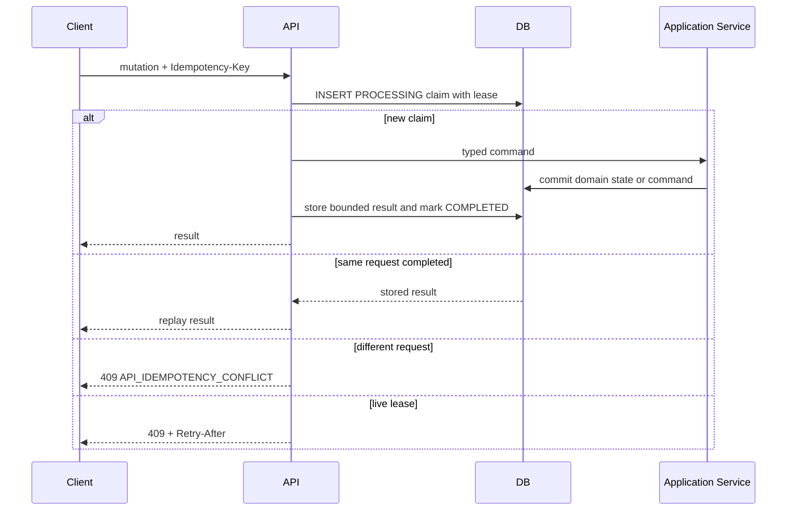

# Application API Idempotency

Every non-authentication mutation requires `Idempotency-Key`. The raw key is validated at the HTTP
boundary and never logged or persisted. The database key is an HMAC-SHA-256 of the supplied key.
The request digest is canonical JSON over method, operation ID, validated path parameters, the
validated body, and Operator ID. Sensitive input is represented by a keyed digest before request
canonicalization.

The compound unique index `(operator_id, endpoint_key, idempotency_key_hash)` is the concurrent
claim invariant. Lookup is O(log n); the response is capped at 64 KiB and retained for at least one
day. `expires_at` is a retention/cleanup eligibility marker, not permission to reuse a key for
different input or forget a completed receipt. V0 has no automatic purge. `FAILED_FINAL` describes
the failed HTTP attempt; the same exact request may acquire a new lease to retry its application
boundary. Durable workflow/build failures and append-only audit events are not changed by that
transport retry. Different input on the same retained key always conflicts.
Token and password-changing endpoints never use this cache. Workflow execution duration does not
extend the API lease: the record is completed when the durable workflow command is registered.

## Atomic local Operator commands

Operator creation and administrator mutations share the API's local database. For those commands,
the idempotency row is locked first and a transaction-scoped Operator service joins that same
transaction. Domain state/events and the bounded completed reply commit together. A crash before
commit rolls both back; a crash after commit replays the original reply rather than attempting to
create another account or apply an old ETag. Operator row version checks remain inside the domain
application mutation. No new receipt table, queue, distributed transaction or binary data is added.
The scope object is per call, never a mutable global/service session. Cross-service commands retain
their existing durable domain-key recovery; a local transaction is not claimed to cover an RPC.

Access is an indexed claim lookup plus the command's existing indexed target/advisory locks,
O(log n) metadata and one bounded reply. Consistent order is claim -> IAM invariant lock (where
needed) -> Operator row -> session/token locks. A router pre-read or storing the reply only after
the domain commit leaves a crash window and was therefore insufficient. Fault-before-receipt,
lost-response replay, stale-owner and concurrent-CAS cases use disposable PostgreSQL.

Workflow start keeps this transport identity separate from business equivalence. A keyed digest of
the operator, `workflow_start`, and raw Idempotency-Key identifies one workflow submission without
persisting the raw key. The workflow's deterministic `request_hash` identifies equivalent business
input for active-work detection and audit; it is not a permanent exactly-once key. Consequently a
new API key after a terminal FAILED or CANCELLED occurrence can create a new `workflow_id`, while
same-key replay still returns the original occurrence and an equivalent active occurrence prevents
parallel work. See ADR 0031.

Workflow human actions use the same transport-to-domain derivation. The durable command key is a
keyed digest scoped by Operator, action endpoint, and raw Idempotency-Key. This makes an exact
replay resolve the same command while allowing a new immutable command occurrence after an older
command failed. The raw key is not persisted, and approval snapshot locking still resolves races
between different action keys.
